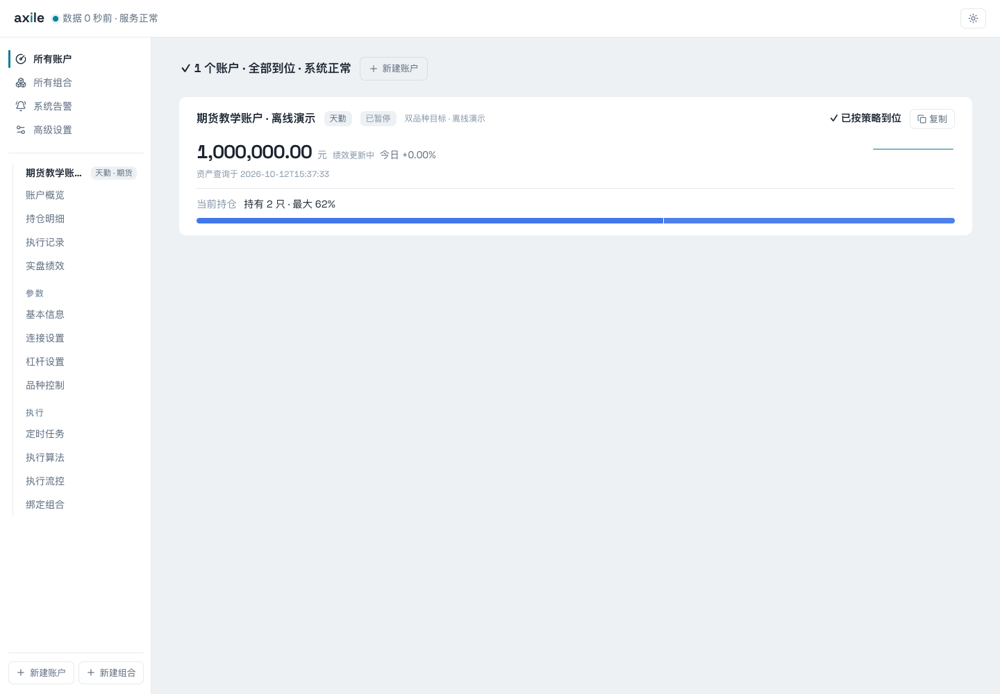
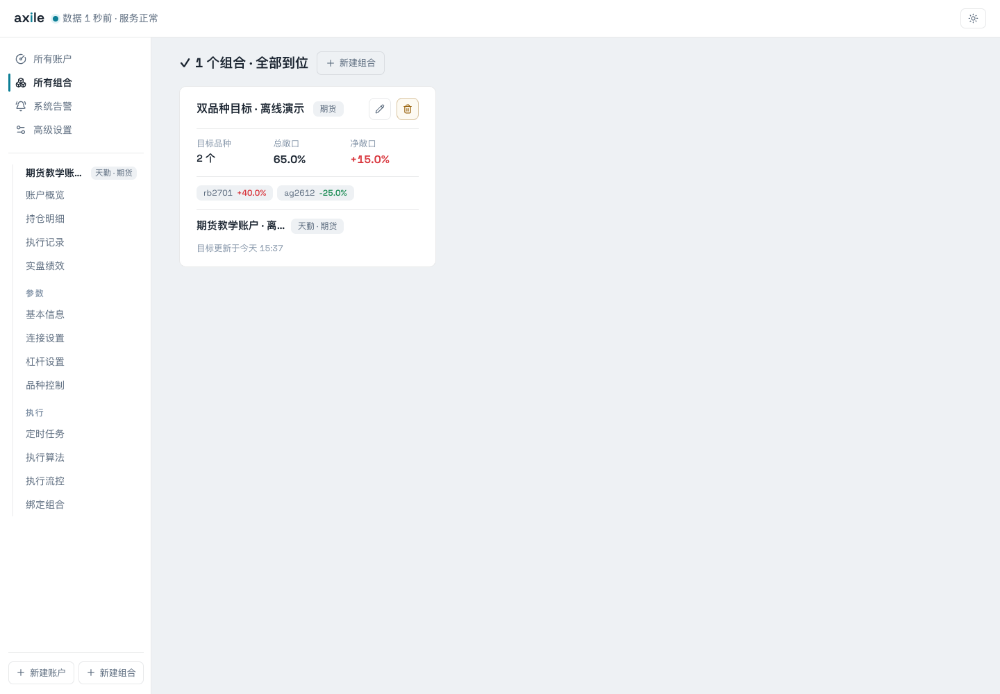
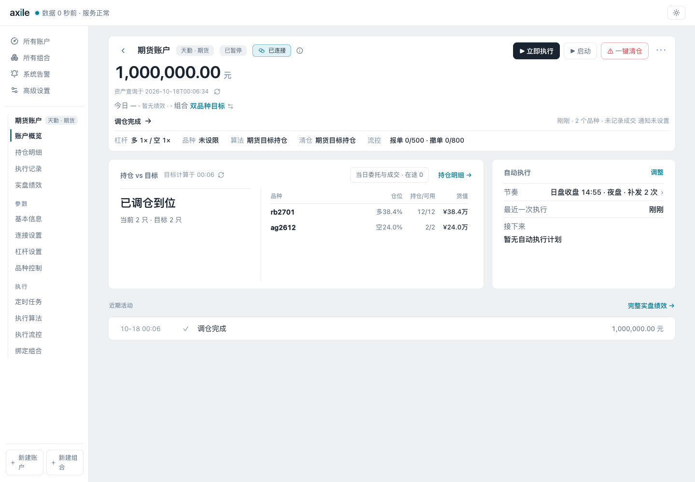

# Axile

[](https://pypi.org/project/axile/)

Axile 是一个通过 Web 界面配置和运行的交易执行服务。输入投资组合的目标权重或目标数量后，它按品种交易规则规划并执行调仓；权重模式会根据账户权益换算数量。内置 CTP、天勤和掘金渠道，支持插件扩展。

[使用文档](https://schwartx.github.io/axile/) · [创建第一个组合](https://schwartx.github.io/axile/guide/first-portfolio.html)

## 功能

- 用 Python 编写和试跑组合函数，编辑器支持代码补全和类型检查。
- 多个账户跟随同一组合，分别设置杠杆、算法和执行时间。
- 手动或定时调仓，支持期货目标持仓、SINGLE-MAKER、TWAP 和 POV 等算法。
- 查看连接状态、持仓与目标差异、委托成交和执行记录。
- 配置操作额度、品种控制和通知。

## 界面

| 账户总览 | 组合列表 |
| --- | --- |
|  |  |



## 安装

需要 Python 3.12 或以上。使用 [uv](https://docs.astral.sh/uv/) 从 [PyPI](https://pypi.org/project/axile/) 安装，以天勤渠道为例：

```bash
mkdir axile-workspace
cd axile-workspace
uv venv --python 3.12
uv pip install 'axile[tqsdk]'
uv run axile
```

打开 <http://127.0.0.1:8000>，按向导完成初始化，保存后重新运行 `uv run axile`。后续从同一目录启动。

CTP 和掘金分别安装 `axile[ctp]`、`axile[gm]`，平台限制与账户模式见[渠道与配置](https://schwartx.github.io/axile/reference/channels.html)。服务仅允许监听本机回环地址。

### Alpha 试用

`next` 分支的首个预发布版本为 `0.25.0a1`，包含 Rust 原生存储、执行回放、数量目标和算法时段设置。此版在 PyPI 提供 Linux x86_64 wheel，要求 Python 3.12 或以上；Windows、macOS 和其他架构暂不提供预编译包。

建议使用独立目录和虚拟环境，以天勤渠道为例：

```bash
mkdir axile-alpha
cd axile-alpha
uv venv --python 3.12
uv pip install 'axile[tqsdk]==0.25.0a1'
uv run axile
```

先用新建数据库或停服后备份的旧库副本试用。此版迁移终点为 `0036`；旧于 `0033` 的库需先使用稳定版升级。首次启动可能重算绩效，直接降包版本不能恢复旧数据库。恢复升级前备份会失去备份之后的新增记录，不能覆盖仍需保留的新数据。详细步骤见 [Alpha 发布与试用](docs/releases/0.25.0-alpha.md)。

### 从源码运行

源码构建需要 Rust、C 编译环境和 [Bun](https://bun.sh/)，步骤见[安装与启动](https://schwartx.github.io/axile/guide/install.html)。发布包已包含原生扩展与 Web 界面，无需自行构建。算法行为见[执行算法](https://schwartx.github.io/axile/reference/algorithms.html)，结果核对见[查看执行结果](https://schwartx.github.io/axile/guide/results.html)。

本项目采用 Apache-2.0 许可证。
