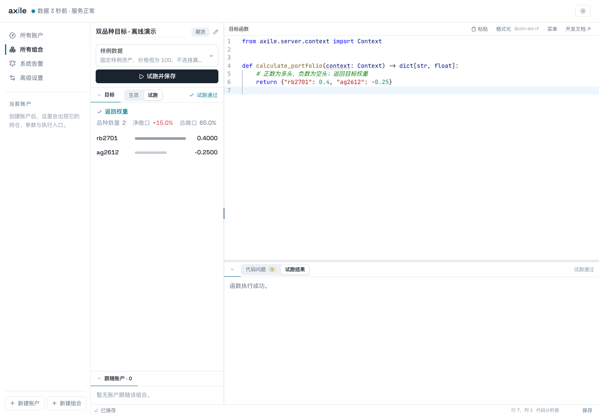

# 03 · 跑通第一个组合

目标：创建组合，验证函数返回值，创建一个账户并绑定它，理解下一步执行入口。

图说：先用样例数据验证函数能返回两个品种的目标权重。正数代表多头、负数代表空头；试跑通过后保存函数。固定权重函数不使用 `context`，编辑器可能提示参数未使用，这与运行失败不同。

| 顺序 | 图片 | 操作与预期结果 |
| --- | --- | --- |
| 1 | [创建组合](../../site/assets/screenshots/03-first-portfolio/01-create-portfolio.png) | 输入名称、选择期货市场，创建并编辑 |
| 2 | [样例试跑](../../site/assets/screenshots/03-first-portfolio/02-sample-run.png) | 输入最小函数，看到 rb2701 为 0.4、ag2612 为 -0.25 |
| 3 | [选择公共渠道](../../site/assets/screenshots/03-first-portfolio/03-public-channels.png) | 选择天勤；公开环境只显示 CTP、掘金和天勤 |
| 4 | [连接演示账户](../../site/assets/screenshots/03-first-portfolio/04-connect-demo-account.png) | 选择本地模拟，填写账号、密码和初始资金 |
| 5 | [绑定组合](../../site/assets/screenshots/03-first-portfolio/05-bind-portfolio.png) | 选择刚才创建的组合 |
| 6 | [交易方式](../../site/assets/screenshots/03-first-portfolio/06-trading-method.png) | 查看期货目标持仓算法、报价方式、等待和追单参数 |
| 7 | [确认账户](../../site/assets/screenshots/03-first-portfolio/07-confirm-account.png) | 计算目标、核对账户和自动执行状态，再创建 |

最小源码见 [fixed_weights.py](../05-functions/examples/fixed_weights.py)。

图中账号为 `offline-docs-main`，密码为无效演示字符串。素材环境使用专用离线替身，所以能在没有真实凭据时完成流程。**正常安装的天勤本地模拟仍需要有效的天勤账号与密码**，不能照抄演示凭据来连接。

向导中的默认多空杠杆为 3。后续教程在账户「杠杆设置」中改为 1，再刷新资产和目标，见 [04 目标与持仓](../04-targets/README.md)。两处截图应按这个顺序讲，避免读者误以为默认杠杆就是 1。

本例先关闭自动调仓，再通过账户「立即执行」触发。该按钮会直接触发执行；真实账户点击前，应先核对组合、杠杆和目标。结果图见 [完整执行详情](../../site/assets/screenshots/07-results/01-completed-execution.png)。
