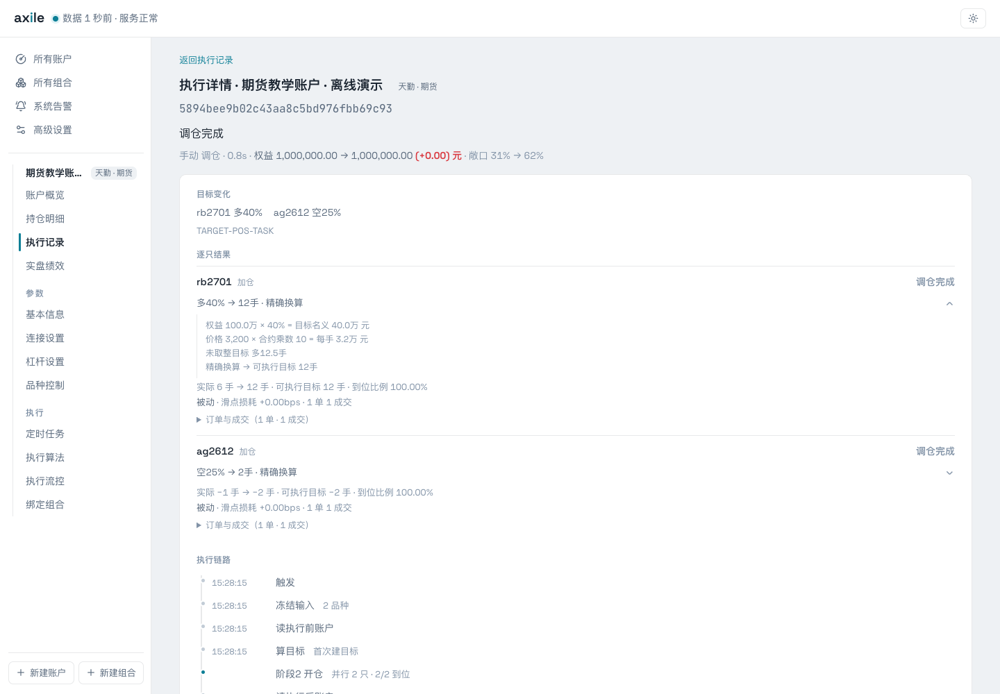

# 04 · 理解目标权重与持仓

目标：解释为什么返回 40% 的权重，界面最终显示多 12 手、38.4% 的持仓，仍然可以到位。

图说：展开品种的目标数量，可以看到权益、账户目标权重、价格和合约乘数。原始计算为 12.5 手，国内期货数量按整手向零截断，可执行目标为多 12 手。到位判断比较可执行目标和实际持仓。

| 图片 | 位置 | 说明重点 |
| --- | --- | --- |
| [杠杆设置](../../site/assets/screenshots/04-targets/01-leverage.png) | `/accounts/1/edit/leverage` | 本例把多空杠杆从默认 3 改成 1 |
| [执行前对照](../../site/assets/screenshots/04-targets/02-before-rebalance.png) | `/accounts/1` | 起始多 6 手、空 1 手，两个品种待调整 |
| [执行后对照](../../site/assets/screenshots/04-targets/03-after-rebalance.png) | `/accounts/1` | 多 12 手、空 2 手，达到可执行目标 |
| [换算依据](../../site/assets/screenshots/04-targets/04-sizing-evidence.png) | 首次执行详情，展开 rb2701 目标 | 权重、权益、价格、乘数、取整前后数量 |
| [持仓明细](../../site/assets/screenshots/04-targets/05-holdings-detail.png) | `/accounts/1/holdings` | 原始百分比与可执行数量同时查看 |

本例多空杠杆均为 1，权重精度为 0.01：

| 品种 | 账户目标 | 每手名义价值 | 计算数量 | 可执行目标 | 实际名义敞口 |
| --- | ---: | ---: | ---: | ---: | ---: |
| rb2701 | 40% | 3,200 × 10 = 32,000 元 | 400,000 / 32,000 = 12.5 | 多 12 手 | 384,000 元，即 38.4% |
| ag2612 | -25% | 8,000 × 15 = 120,000 元 | -250,000 / 120,000 = -2.0833 | 空 2 手 | 240,000 元，即 -24.0% |

这里的权重按账户权益与合约名义价值解释。保证金占用与名义敞口需要分开讲。杠杆、精度和品种限制在账户层处理，不能仅凭函数返回值推断最终订单数量。

数量口径对应 `axile/channels/cn_futures.py::quantize_cn_futures_quantity`。图中的“精确换算”表示已有足够换算依据，过程中仍会按整手截断。
