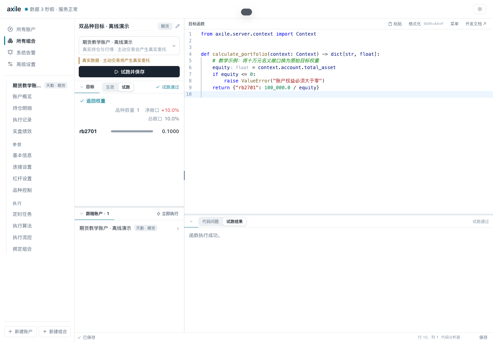

# 05 · 编写自定义组合函数

目标：从固定权重开始，学会选择上下文、读取权益、定位错误，再接入自己的信号。

图说：函数读取 `context.account.total_asset`，把十万元名义敞口换成原始目标权重。演示权益为一百万元，所以返回 0.1。这里仅说明接口用法，账户杠杆仍在后续执行阶段处理。

| 图片 | 操作 | 说明重点 |
| --- | --- | --- |
| [数据来源选择](01-data-source.png) | 打开「试跑数据来源」 | 样例与账户上下文的区别 |
| [账户上下文试跑](02-account-context-run.png) | 选择教学账户，再试跑并保存 | 通用 Context 来自选定账户；本环境提供离线夹具 |
| [报错定位](03-runtime-error.png) | 把 `total_asset` 故意拼成 `total_assets` | AttributeError、错误行号、定位按钮、traceback |
| [修正后通过](04-equity-to-weight.png) | 改回正确字段，并处理非正权益 | 读权益、计算返回值、检查试跑输出 |

建议分四步写正文：

1. **固定权重**：[fixed_weights.py](examples/fixed_weights.py)，先解释字典、标的代码、正负号和返回值。
2. **读取账户**：[equity_to_weight.py](examples/equity_to_weight.py)，说明 Context、快照和异常处理。
3. **定位错误**：使用截图中的字段拼写错误演示，不把错误代码当作可运行模板发布。
4. **接入自己的信号**：[csv_weights.py](examples/csv_weights.py) 与 [target_weights.csv](examples/target_weights.csv)，从本地 CSV 读取目标，检查重复品种、空输入和非有限数字。本例还应配上“上游生成 CSV → 函数读取 → 试跑 → 执行”的流程图。

素材中的前两段正确函数和故意错误函数都经过实际试跑；CSV 示例在同一独立环境中单独验证。当前保存的主组合已恢复为固定双品种目标。

**必须挨着试跑按钮说明的边界**：样例数据不会连接真实渠道；选择真实账户时，Axile 不会自动执行试跑返回的目标，但用户函数主动调用完整 executor 的交易方法仍会产生委托。因此入门示例只使用查询与返回权重。

返回值必须是 `dict[str, float]`，数值有限，布尔值不算数字。空字典表示目标空仓。普通页面读取展示已保存快照，显式试跑、刷新目标和执行前计算才会调用函数。完整字段参考放到 [08](../08-reference/README.md)。
