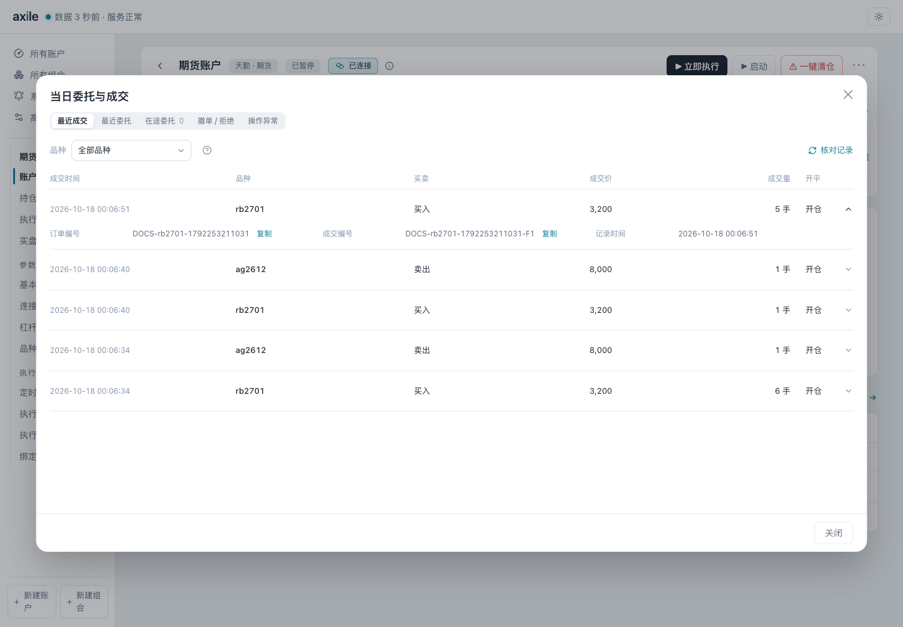
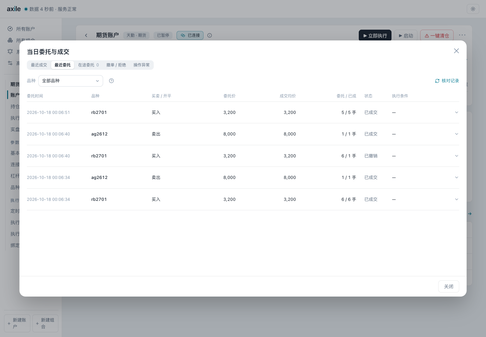
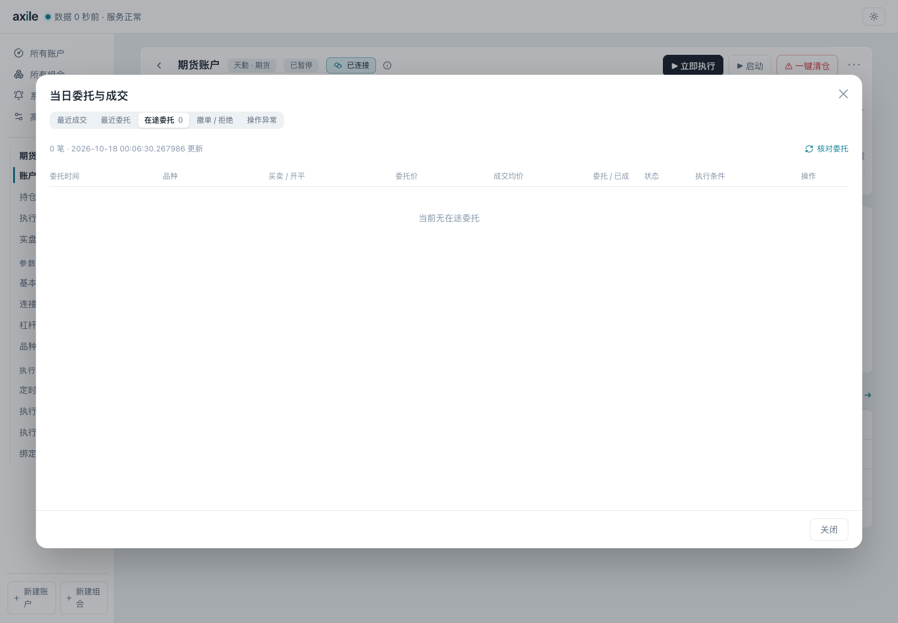

# 07 · 查看委托与成交

在账户概览点击“当日委托与成交”。这里查看账户渠道记录；要核对某一次调仓，进入对应的[执行详情](/guide/results)。

## 选择记录类型

| 页签 | 查看什么 |
| --- | --- |
| 最近成交 | 已发生的成交及成交明细 |
| 最近委托 | 渠道返回的委托和当前状态 |
| 在途委托 | 尚需跟踪的委托、剩余数量和撤单操作 |
| 撤单 / 拒绝 | 已撤销、拒绝或过期的委托 |
| 操作异常 | 查询、下单或撤单等操作的异常记录 |

撤单操作失败不会把原委托自动改成已撤。操作异常和委托状态要分别核对。

## 按品种核对记录

选择“全部品种”或具体品种。列表中没有所需代码时，选择“输入其他品种…”，填写完整代码并筛选。点击“记录范围说明”，检查渠道实际提供的范围。

点击“核对记录”重新查询。默认读取最近 100 笔，出现“加载更多”时可逐步增加到 500 笔。不同渠道可查询的时间范围和历史覆盖不同，弹窗标题不能作为完整历史的保证。

记录为空时，先检查连接是否就绪、品种筛选、范围说明和读取错误。页面显示上次结果或读取不完整时，不能据此认定账户没有委托或成交。

## 展开成交和委托明细

展开记录行，核对订单编号、时间、数量、价格和关联信息。买卖方向与开平仓含义分别查看；渠道未提供的字段保留为空，不自行推断。

成交均价与单笔成交价可能不同。费用字段按渠道提供的内容展示，缺少费用不表示费用为零。数量单位也随渠道变化。

## 核对在途委托

先点击“核对委托”，查看剩余数量和状态。需要撤单时，确认品种和订单编号，再点击对应行的“撤单”。连接未就绪、记录过期或状态不确定时，部分操作会暂时不可用。

撤单后继续看结果。请求已提交不等于柜台已确认撤销；显示未知或待确认时，应再次核对，避免把仍在途的委托当成已结束。

## 查看操作异常

“操作异常”记录操作失败的原因，与“撤单 / 拒绝”中的订单终态分开。排查时保留操作时间、品种、订单编号和错误原因，必要时结合执行证据。

关闭弹窗再打开时，页面会恢复该账户的页签、筛选和查看位置。切换账户后，确认标题和记录属于当前账户。
