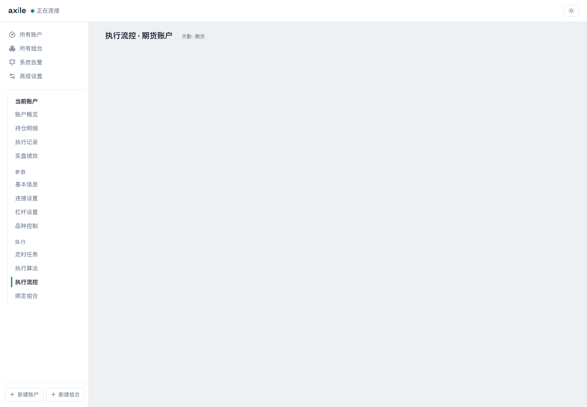
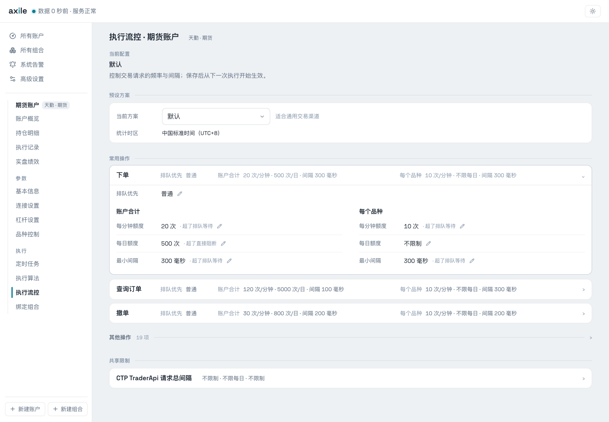
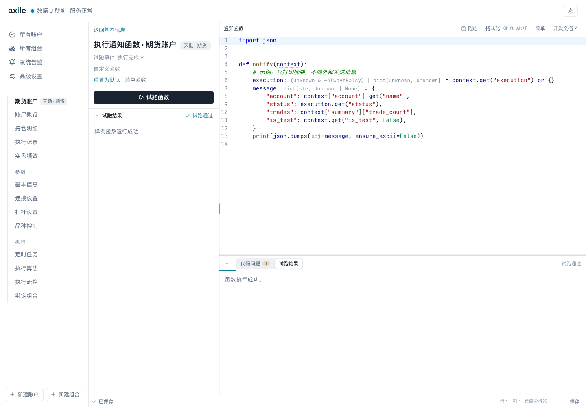
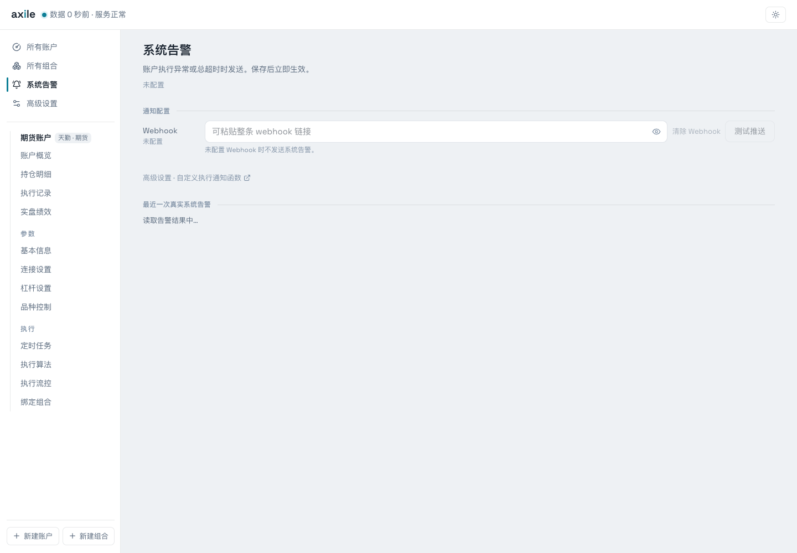

# 06 · 日常运行与配置

手动调仓成功后，可以设置自动执行，并调整下单算法、流控和通知。

## 安排自动调仓

在账户“定时任务”中选择执行时间。快捷设置支持日盘收盘和固定间隔，也可以开启夜盘、预览补发安排。页面使用北京时间。

开启前请检查排程预览中的时间。本例账户保持自动执行关闭。

自动执行关闭时，仍可手动触发调仓。按组合目标调仓需要先绑定组合；设置排程时，要同时检查交易日历和交易时段。

## 理解算法等待与总超时

算法的“最大等待”限制等待委托的时间，账户执行总超时限制整次执行的时间。设置其中一项不会替代另一项。

| 配置 | 解释 |
| --- | --- |
| 报价方式 | 选择本方挂单或对手价；成交仍取决于市场条件 |
| 最大等待 | 等待本轮或单片委托完成的上限，具体以算法说明为准 |
| 追单 | 按条件撤单追价，包含跳数、次数与间隔 |
| 执行总超时 | 约束一次执行的总预算，到期触发终止处理 |

公共算法及适用范围见[执行算法](/reference/algorithms)。等待结束后，应核对最终持仓和订单状态。

## 配置执行流控

“执行流控”分别设置下单、查询、撤单等操作的频率限制，可以限制整个账户，也可以限制单个品种。

展开“下单”可查看每分钟额度、每日额度、最小间隔，以及超额时排队还是阻断。

图中为当前预设值，不能直接作为所有渠道的推荐参数。保存后从下一次执行开始生效。

## 设置品种控制

“禁投”用于不建仓的品种，“风险品种”限制为仅减不加。输入支持 Enter、Tab、逗号或空格确认，也可以批量粘贴。

图中用 au2612 和 cu2611 展示标签输入，组合中的品种仍为 rb2701 与 ag2612。

## 编写账户通知函数

账户执行通知接收脱敏的事件快照。下面的函数只打印摘要，可以用来查看字段和试跑事件：

<<< ../examples/notify_summary.py

试跑执行的是当前草稿，后续通知使用的是已保存的函数。函数如果接入了外部服务，试跑也可能发送消息，需要检查 `is_test`。同步、异步入口和可选字段见[通知函数参考](/reference/notifications)。

## 配置系统执行告警

执行异常或总超时时可发送系统告警。它有单独的设置入口，支持默认 Webhook 和自定义函数。

未配置 Webhook 时不发送默认告警。示例通知只打印本地摘要，没有向外部服务发送消息。
