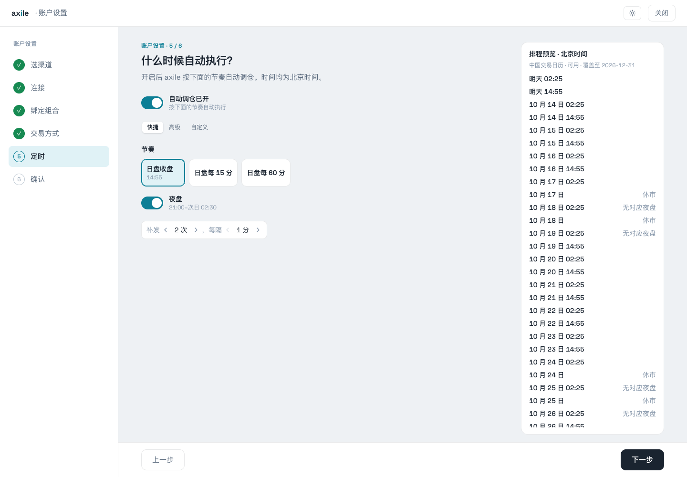
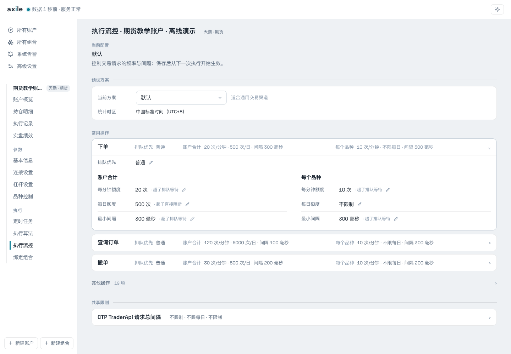
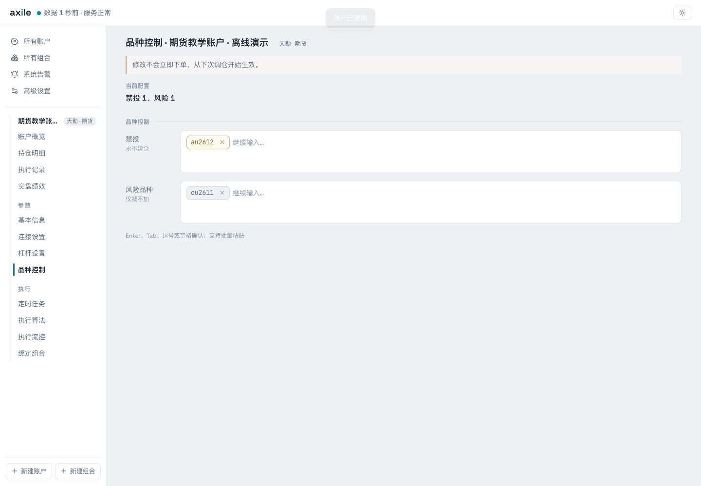
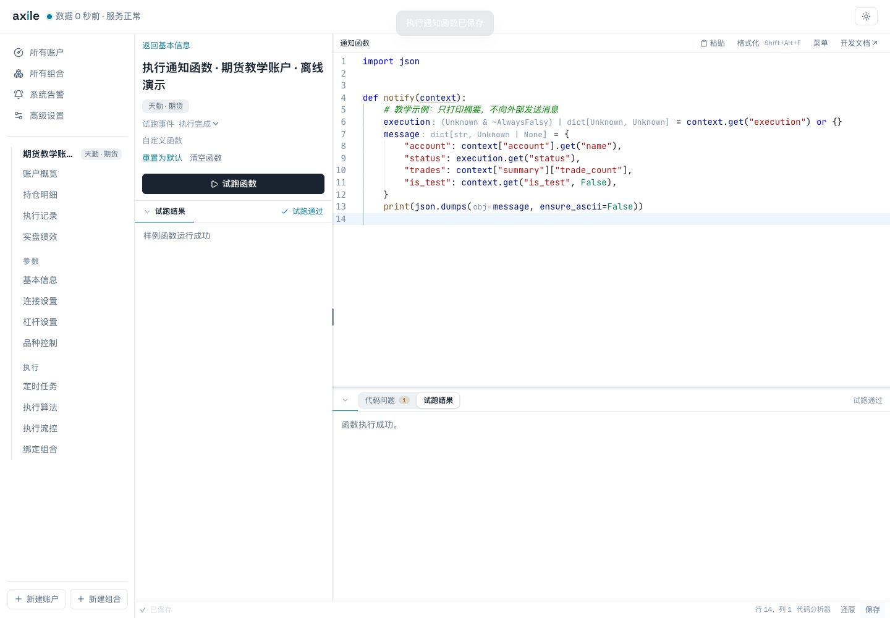
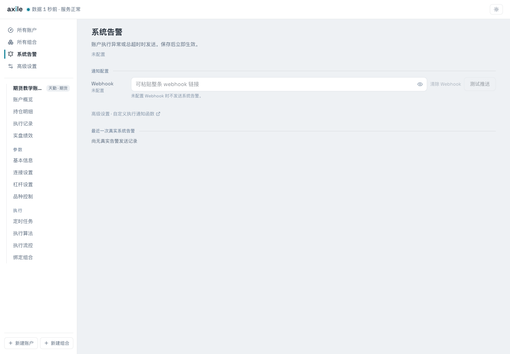

# 06 · 日常运行与配置

手动跑通以后，再配置自动执行、下单算法、流控和通知。它们各自控制执行链路的一部分。

## 安排自动调仓

在账户“定时任务”中设置节奏。快捷方式可以选择日盘收盘或固定间隔，按需开启夜盘，并预览补发安排。页面时间为北京时间。

开启自动执行之前，先看预览中的实际时间。教程账户最终保持自动执行关闭。

关闭自动执行后，仍可以手动触发。账户还需要绑定组合，才能按组合目标调仓。排程与交易日历、交易时段应一起核对。

## 理解算法等待与总超时

下单算法的“最大等待”控制算法等待委托的预算；账户执行总超时约束整个执行过程。两者不能互相替代。

| 配置 | 解释 |
| --- | --- |
| 报价方式 | 选择本方挂单或对手价；成交仍取决于市场条件 |
| 最大等待 | 等待本轮或单片委托完成的上限，具体以算法说明为准 |
| 追单 | 按条件撤单追价，包含跳数、次数与间隔 |
| 执行总超时 | 约束一次执行的总预算，到期触发终止处理 |

公共算法及适用范围见[执行算法](/reference/algorithms)。等待结束后，应核对最终持仓和订单状态。

## 配置执行流控

“执行流控”按下单、查询、撤单等操作展示限制。限制可能作用于账户合计，也可能作用于每个品种。

展开“下单”，可以查看每分钟额度、每日额度和最小间隔，以及超额后的排队或阻断行为。

图中数字是当前预设的展示，不是适用于所有渠道的统一参数建议。保存后从下一次执行开始生效。

## 设置品种控制

“禁投”用于不建仓的品种，“风险品种”限制为仅减不加。输入支持 Enter、Tab、逗号或空格确认，也可以批量粘贴。

这里使用 au2612 和 cu2611 演示输入。主教学组合包含 rb2701 与 ag2612。

## 编写账户通知函数

账户执行通知接收脱敏的事件快照。先使用一个只打印摘要的函数，理解字段和试跑事件：

<<< ../../guide-materials/06-daily/examples/notify_summary.py

试跑会执行当前草稿；保存后才用于后续通知。真实通知函数可能在试跑时向外发消息，应处理 `is_test`。同步、异步入口以及可选字段见[通知函数参考](/reference/notifications)。

## 配置系统执行告警

系统告警用于执行异常或总超时，其设置入口与账户执行通知不同。可以配置默认 Webhook，也可以使用自定义函数。

未配置 Webhook 时不发送默认告警。示例通知只打印本地摘要，没有向外部服务发送消息。
