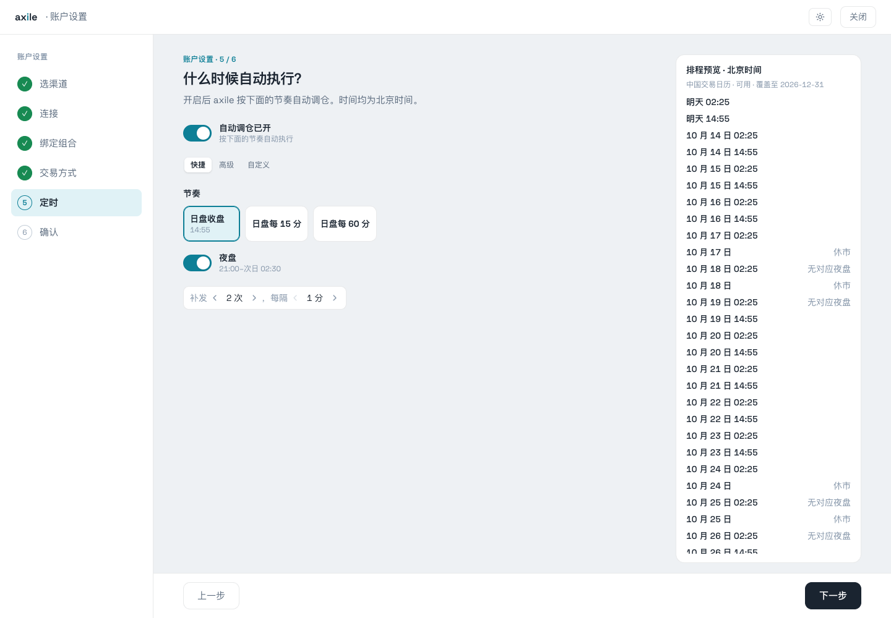
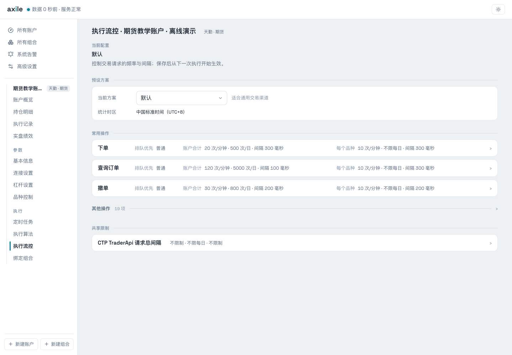
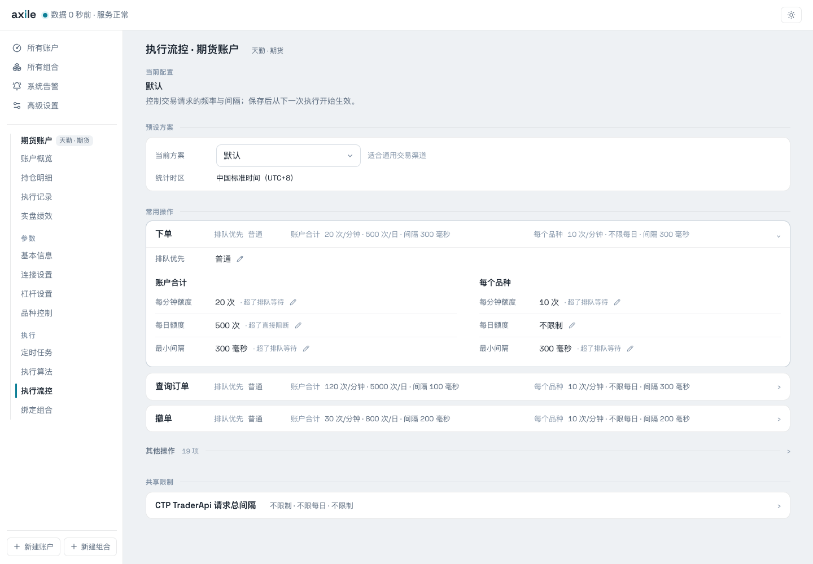
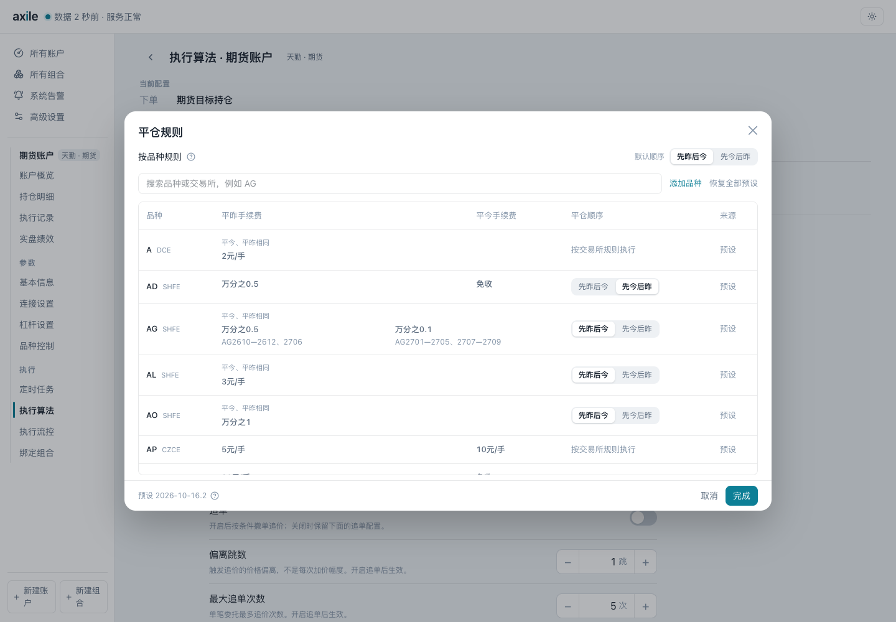
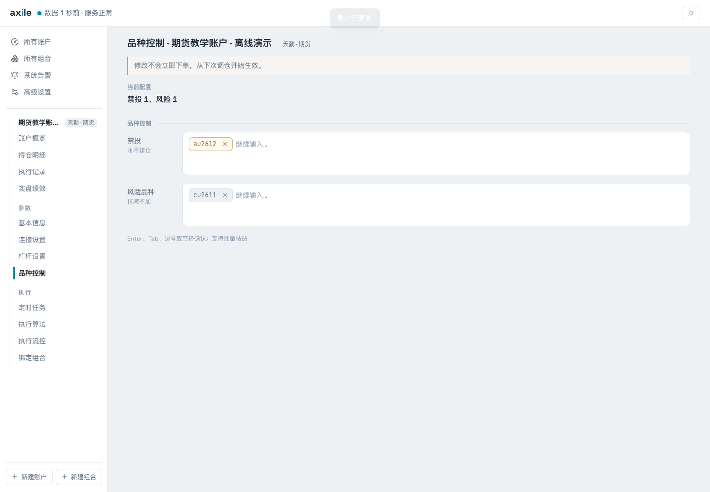
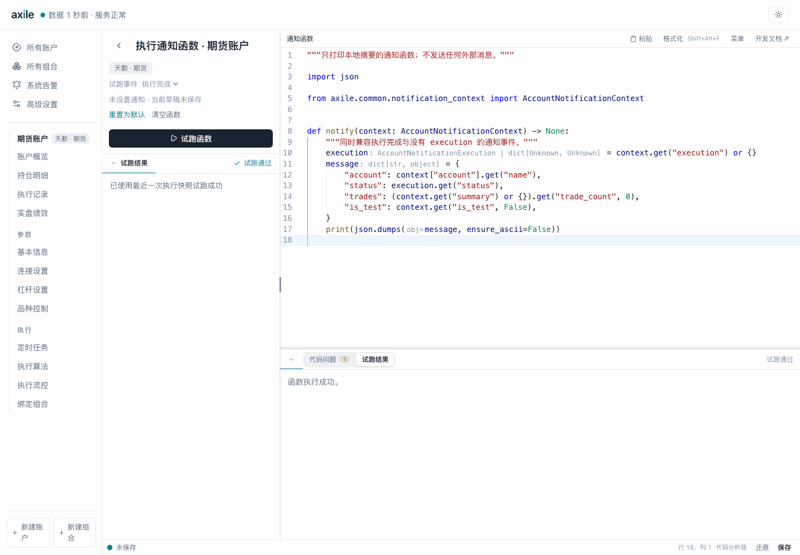
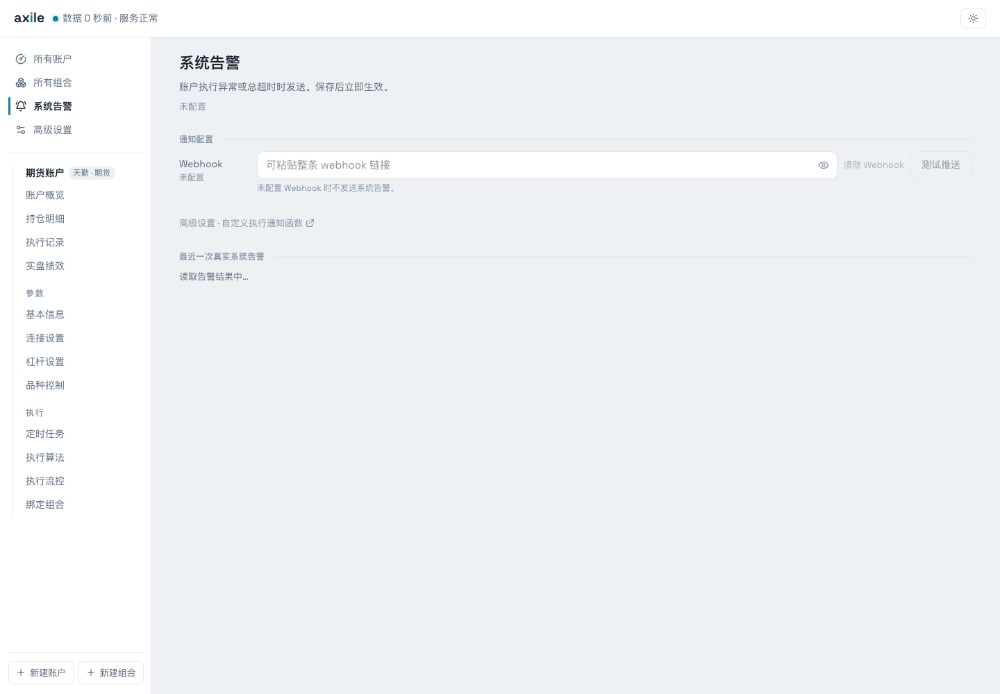

# 06 · 日常运行与账户控制

手动调仓成功后，可以设置自动执行，并调整下单算法、流控和通知。

## 安排自动调仓

在账户“定时任务”中选择执行时间。快捷设置支持日盘收盘和固定间隔，也可以开启夜盘、预览补发安排。页面使用北京时间。

股票（GM）另有三个默认关闭的竞价阶段开关：早盘可撤单阶段固定 09:15 触发，早盘不可撤单阶段可选择 09:20–09:24 触发，收盘集合竞价固定 14:57 触发。早盘不可撤单阶段可调整触发时间，其余阶段时间固定；每个开启阶段独立触发一次；普通盘中节奏止于 14:57 前，临收预设仍为 14:50。09:25–09:30 只等待已有订单，不新增委托或撤单。盘后定价交易需验证渠道能力，目前不可开启。

竞价执行使用账户选择的算法和原有超时额度，不改写追单或缺失盘口参数；渠道仅允许提交有效限价单。当前禁止撤单时，公共委托处理保留原单、继续接收成交与状态回报，未确认原单结束前不报替代单。到期仍未确认结束的委托会保留原因，后续执行须先清理确认。补发不跨阶段，普通定时任务遇到账户忙时跳过。关闭自动调仓或停止账户后，阶段开关不会单独启动任务。阶段设置在任务准入时固定，保存新设置只影响后续任务。

开启前请检查排程预览中的时间。本例账户保持自动执行关闭。

自动执行关闭时，仍可手动触发调仓。按组合目标调仓需要先绑定组合；设置排程时，要同时检查交易日历和交易时段。

## 理解算法等待与总超时

算法的“最大等待”限制等待委托的时间，账户执行总超时限制整次执行的时间。设置其中一项不会替代另一项。

| 配置 | 解释 |
| --- | --- |
| 报价方式 | 选择本方挂单或对手价；成交仍取决于市场条件 |
| 最大等待 | 等待本轮或单片委托完成的上限，具体以算法说明为准 |
| 追单 | 按条件撤单追价，包含跳数、次数与间隔 |
| 执行总超时 | 约束一次执行的总预算，到期触发终止处理 |

公共算法及适用范围见[执行算法](/reference/algorithms)。等待结束后，应核对最终持仓和订单状态。

## 配置执行流控

“执行流控”分别设置下单、查询、撤单等操作的频率限制，可以限制整个账户，也可以限制单个品种。

展开“下单”可查看每分钟额度、每日额度、最小间隔，以及超额时排队还是阻断。

图中为当前预设值，不能直接作为所有渠道的推荐参数。保存后从下一次执行开始生效。

## 查看额度与预警

在执行流控中展开操作分类，设置每日额度和预警比例。每日额度为正数时，才能设置比例；额度不限或为 0 时，预警暂停。

达到预警线和额度用尽时，页面分别自动提醒一次。关闭浮窗后，额度状态仍保留。账户、操作和统计日相同的提醒会去重；看到“数据待更新”时，先核对最新状态，再判断还有多少可用额度。

页面提醒和系统通知分别查看。系统额度预警沿用系统告警的发送方式，同一账户、操作和统计日只发送一次。未配置发送方式时，不能凭页面浮窗判断通知已送达。

## 配置期货平仓规则

支持此设置的期货账户，在“交易算法”页面点击“平仓规则”。按字母品种代码查找，例如 `AG`，不填合约月份。

“按品种规则”依次采用人工覆盖、程序预设和默认顺序。“低手续费优先”仅在渠道支持且费用可比较时使用；同费或不可比较时，再按覆盖、预设和默认顺序处理。界面提供的模式随渠道变化。

规则用于常规调仓和清仓。优先仓位不足时，继续平另一类仓位；不支持选择平今、平昨的交易所按交易所规则执行。表中的手续费是预设参考，空白表示未知，实际费用以账户费率为准。

点击弹窗“完成”后，还要保存交易算法页面，设置才会用于后续执行。

## 设置品种控制

“禁投”用于不建仓的品种，“风险品种”限制为仅减不加。输入支持 Enter、Tab、逗号或空格确认，也可以批量粘贴。

图中用 au2612 和 cu2612 展示标签输入，组合中的品种仍为 rb2701 与 ag2612。

## 编写账户通知函数

账户执行通知接收脱敏的事件快照。账户已有执行记录后，可以用最近一次执行快照试跑通知函数，并选择“执行完成”或“补发取消”事件。下面的函数只打印摘要：

<<< ../examples/notify_summary.py

试跑执行的是当前草稿，后续通知使用的是已保存的函数。函数如果接入了外部服务，试跑也可能发送消息，需要检查 `is_test`。同步、异步入口和可选字段见[通知函数参考](/reference/notifications)。

## 配置系统执行告警

执行异常、总超时或达到已配置的额度预警线时可发送系统告警。它有单独的设置入口，支持默认 Webhook 和自定义函数。

未配置 Webhook 时不发送默认告警。示例通知只打印本地摘要，没有向外部服务发送消息。

### 交易行情有效性

目标定量、算法首次取价及新增委托前均检查行情时间与所需价格。行情未就绪或过期时明确阻断，不把未知目标数量当作零；已有订单的查询、撤单及终态核实不受此检查阻止。报价后到提交前再次过期，也不得新增委托。

各渠道保留原取价方式：GM 使用 SDK 快照与订阅回调，竞价行情须属于当前交易日和阶段；TQ 使用订阅快照；CTP 复用交易日、行情年龄配置和盘口规则。公共默认年龄沿用追价的五秒额度，CTP 使用自身配置。行情拒绝原因及原始时间、来源保留在执行事件或行情快照中。
