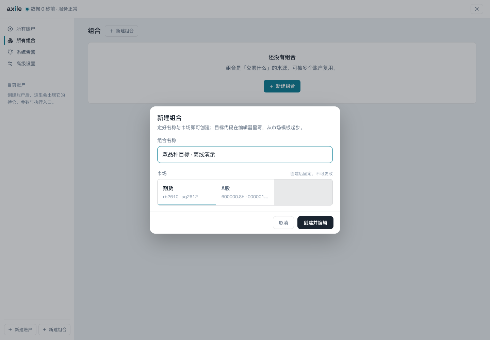
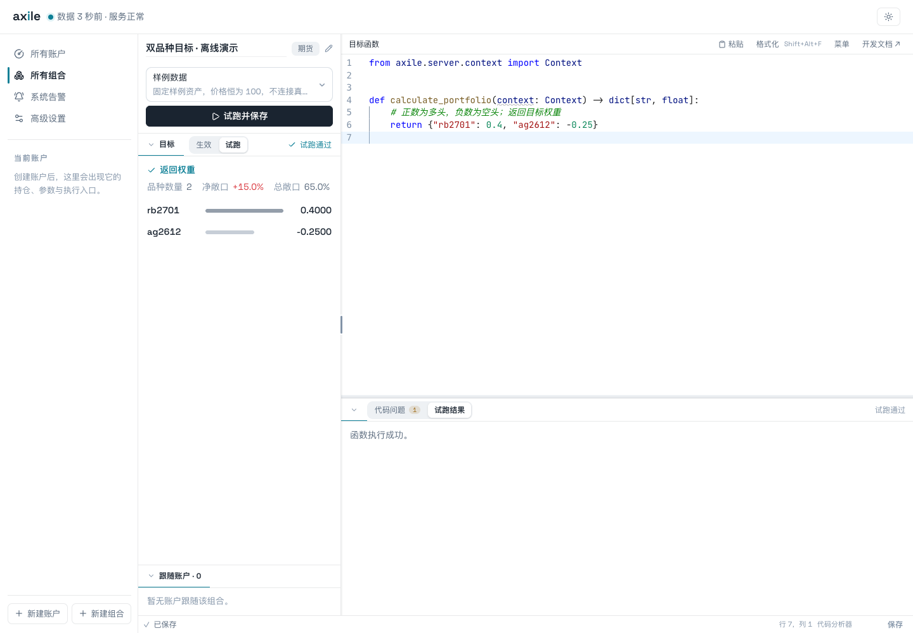
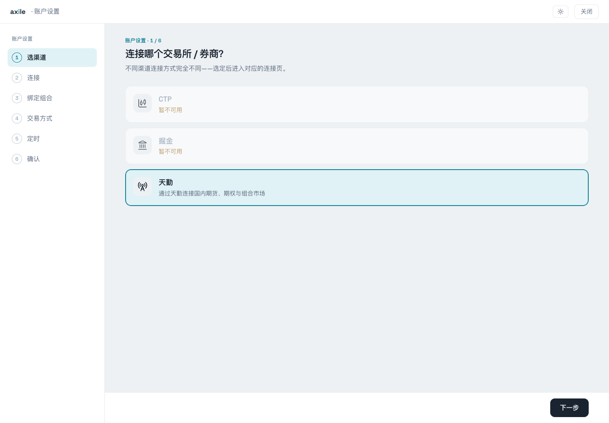
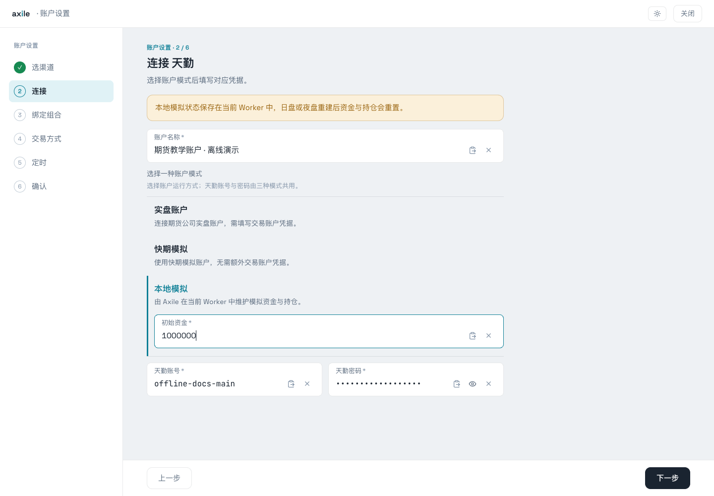
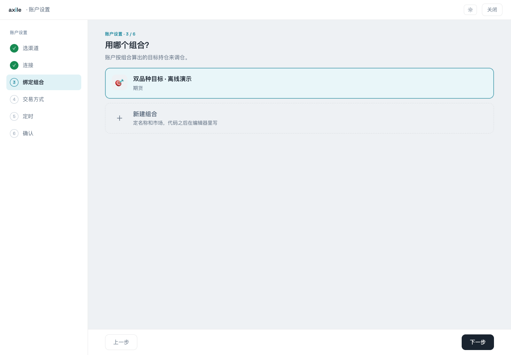
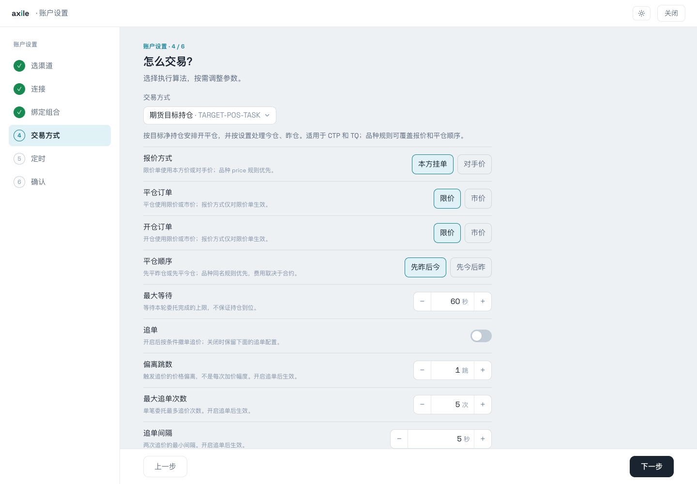
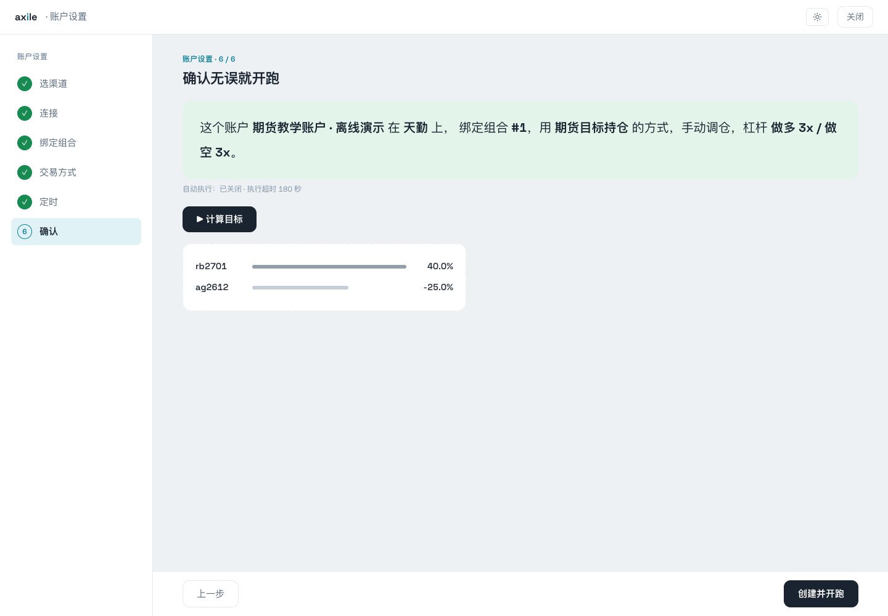
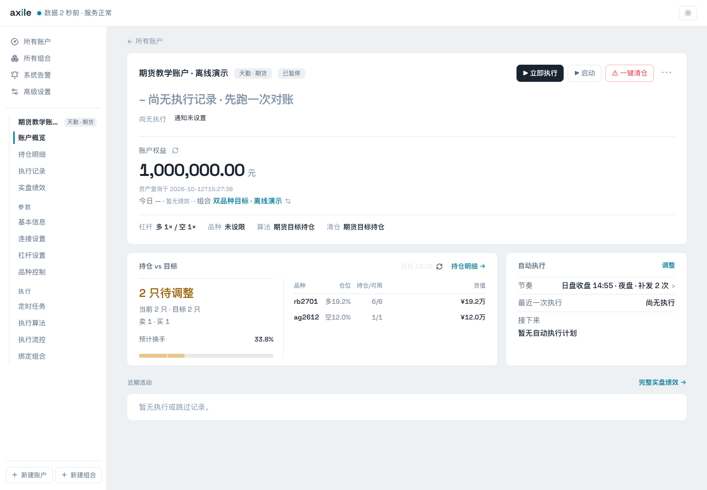
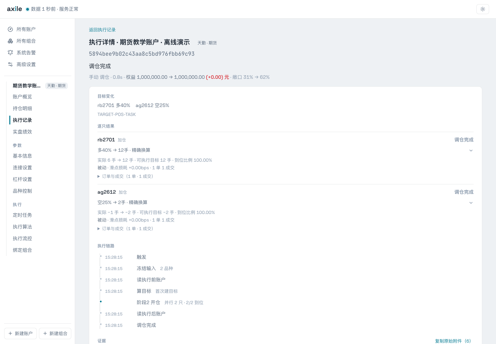

# 03 · 跑通第一个组合

本页走完创建组合、验证函数、创建账户和查看执行结果的完整流程。先完成一次手动操作，再安排自动执行。

::: info 截图中的账户
截图使用离线教学账户，演示凭据不能用于正常连接。正式安装的天勤本地模拟仍需要有效的天勤账号和密码。有关截图环境，见[演示数据说明](/reference/screenshots)。
:::

## 1. 创建组合

点击侧栏“新建组合”，输入名称并选择市场。本例选择“期货”，命名为“双品种目标”。创建后进入函数编辑器。



<p class="caption">市场创建后固定。选好市场后，编辑器会提供对应的初始代码。</p>

## 2. 写入最小目标函数

先使用固定权重，确认返回值含义：

```python
from axile.server.context import Context


def calculate_portfolio(context: Context) -> dict[str, float]:
    return {"rb2701": 0.4, "ag2612": -0.25}
```

选择“样例数据”，点击“试跑并保存”。你应该看到两个品种，权重分别为 `0.4000` 和 `-0.2500`。正数是目标多头，负数是目标空头。



<p class="caption">固定权重函数没有读取 context，编辑器提示参数未使用是代码提示；运行是否通过看“试跑结果”。</p>

::: warning 目标权重与下单数量
`0.4` 表示原始目标权重，不是买 0.4 手，也不是“在现有仓位上加 40%”。账户还会应用杠杆、精度和数量规则，详见[目标与持仓](/guide/targets)。
:::

## 3. 选择账户渠道

点击“新建账户”，选择自己的渠道。本文使用天勤。



<p class="caption">本次环境安装了天勤依赖，CTP 与掘金显示暂不可用。渠道依赖的安装方式见[渠道参考](/reference/channels)。</p>

## 4. 填写连接信息

为账户命名，选择运行模式，再填写对应凭据。天勤有实盘账户、快期模拟和本地模拟三种表单；本地模拟还要填写初始资金。



<p class="caption">图中初始资金为 1,000,000，账号为无效演示字符串。正常使用时填写自己的有效天勤凭据。</p>

本地模拟资金和持仓保存在当前 Worker 中，日盘或夜盘 Worker 重建后会重置。需要连续模拟账户状态时，应理解快期模拟与本地模拟的差异。

## 5. 绑定刚创建的组合

选择“双品种目标”。账户随后使用这个组合计算目标。



同一组合可以供多个账户跟随，账户之间的资金和执行设置仍各自独立。

## 6. 查看交易方式

天勤期货默认使用“期货目标持仓”算法。先理解报价方式、开平仓设置和最大等待；其他算法见[执行算法参考](/reference/algorithms)。



<p class="caption">算法等待到期不保证目标全部完成。实际结果需要在执行详情中确认。</p>

## 7. 先关闭自动执行，再创建账户

在定时步骤先关闭“自动调仓”，然后进入确认页。点击“计算目标”查看返回值，核对账户、组合和算法，再创建账户。



<p class="caption">向导默认多空杠杆为 3。下一步会先把教学账户的杠杆改成 1，以便按相同数字理解目标换算。</p>

## 8. 核对目标后手动执行

进入账户“杠杆设置”，把教学例子的多空杠杆都设为 1 并保存。回到账户概览，先刷新账户资产，再重新计算目标，检查“持仓 vs 目标”。



确认实际账户配置后，点击“立即执行”。这个按钮会直接触发执行。执行结束后，点击结果行进入详情。



到这里，你已经找到从组合函数到订单与成交的完整路径。继续阅读[目标与持仓](/guide/targets)，理解图中的目标手数。
