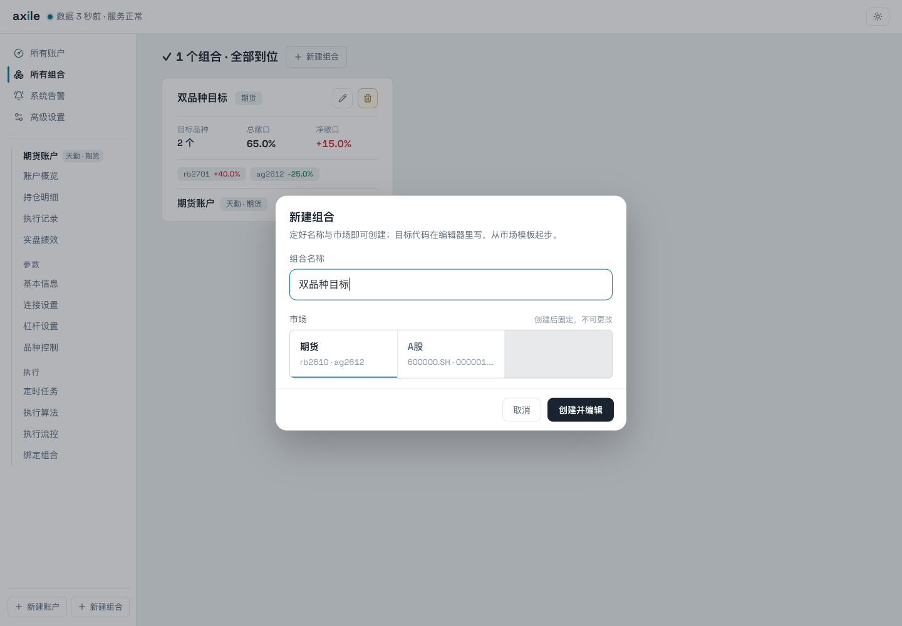
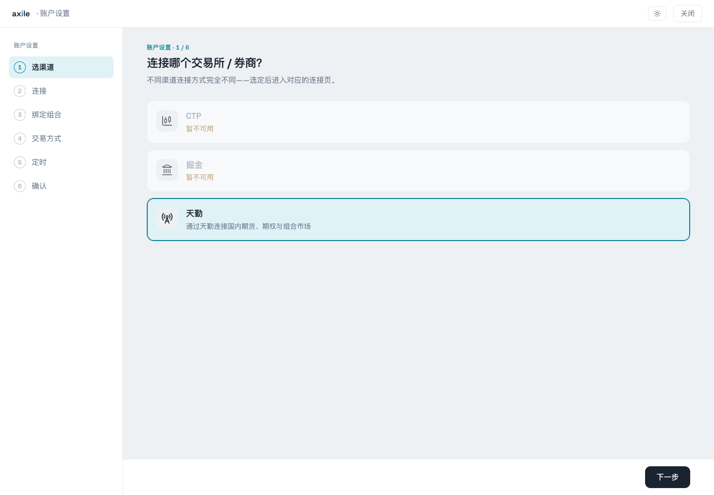
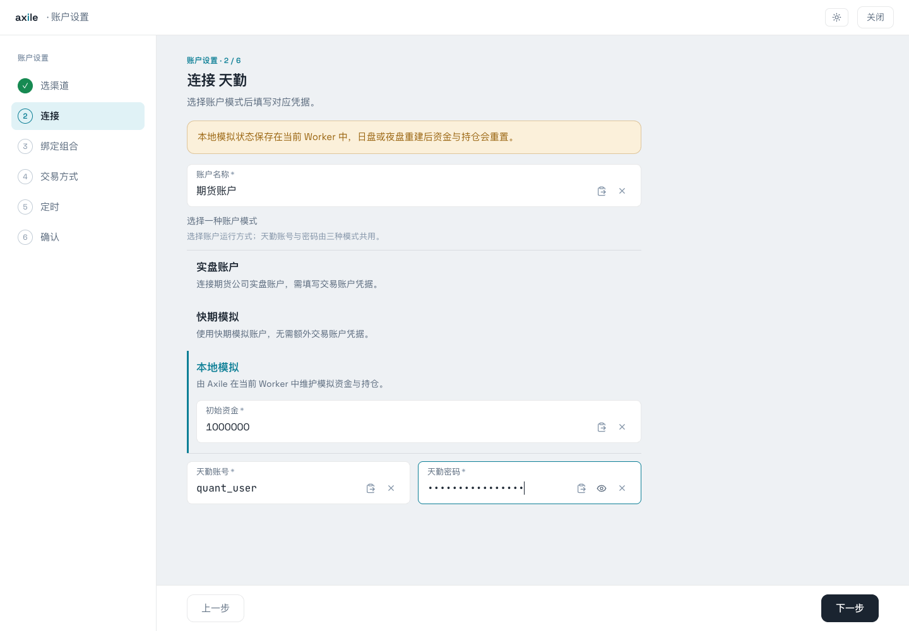
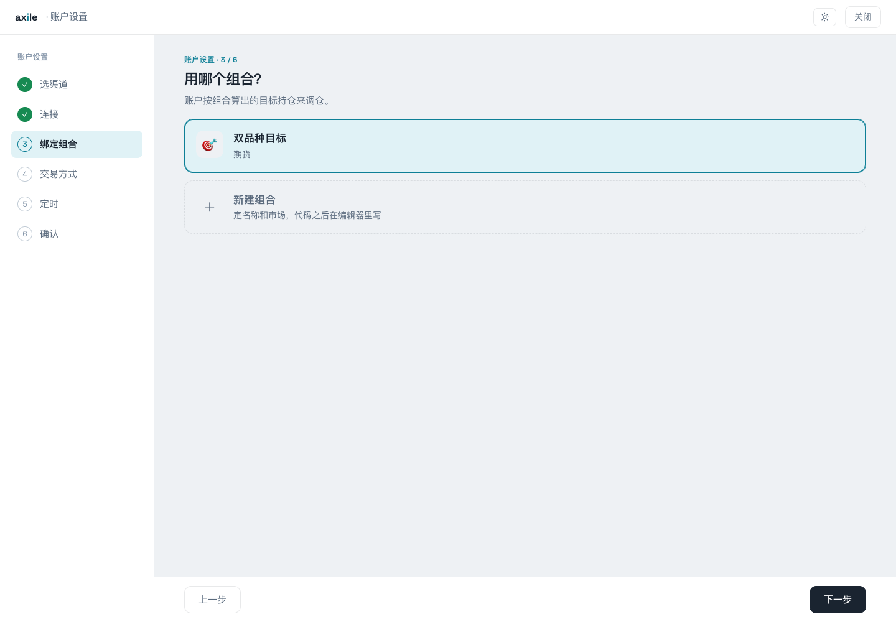
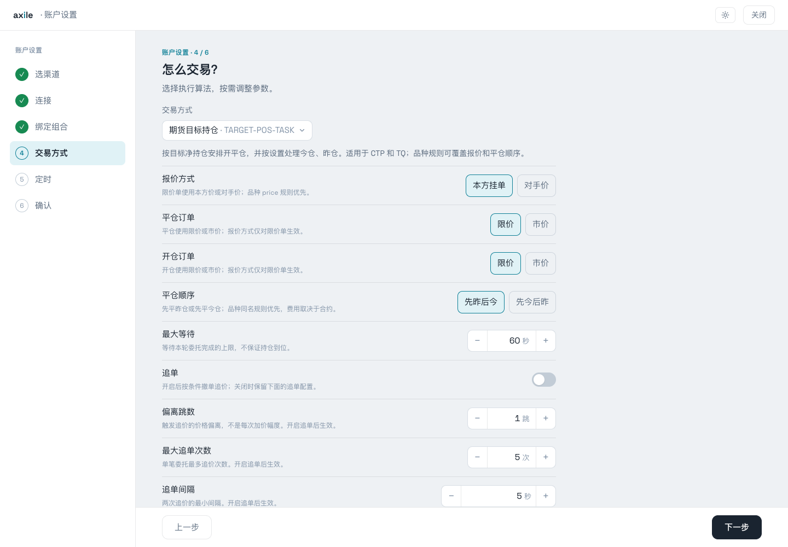
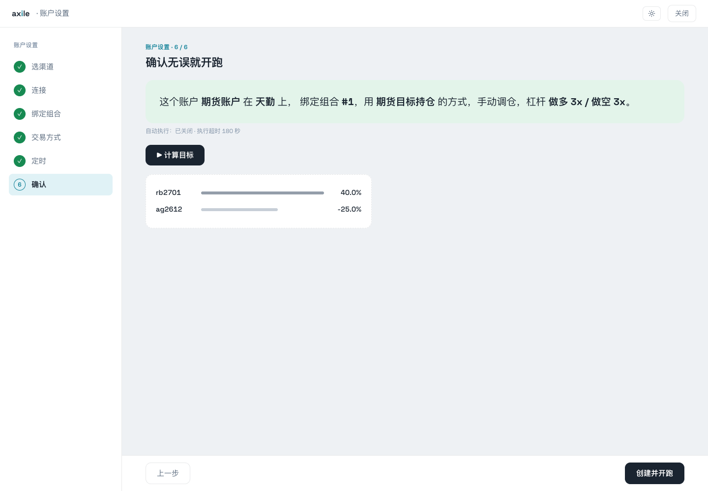

# 03 · 跑通第一个组合

先创建组合和账户，手动执行一次调仓，确认结果后再设置自动执行。

::: info 截图中的账户
截图中的登录信息仅为示例，不能用于连接。天勤本地模拟也需要有效的天勤账号和密码。
:::

## 1. 创建组合

点击侧栏“新建组合”，输入名称并选择市场。本例选择“期货”，命名为“双品种目标”。创建后进入函数编辑器。



<p class="caption">市场创建后固定。选好市场后，编辑器会提供对应的初始代码。</p>

## 2. 写入最小目标函数

先使用固定权重，确认返回值含义：

```python
from axile.server.context import Context


def calculate_portfolio(context: Context) -> dict[str, float]:
    return {"rb2701": 0.4, "ag2612": -0.25}
```

选择“样例数据”，点击“试跑并保存”。结果中会列出两个品种，权重分别为 `0.4000` 和 `-0.2500`，对应目标多头和目标空头。


<p class="caption">这个函数没有读取 context，编辑器会提示参数未使用。函数是否运行成功，看“试跑结果”。</p>

::: warning 目标权重与下单数量
`0.4` 表示原始目标权重，不是买 0.4 手，也不是“在现有仓位上加 40%”。账户还会应用杠杆、精度和数量规则，详见[目标与持仓](/guide/targets)。
:::

## 3. 选择账户渠道

点击“新建账户”，选择自己的渠道。本文使用天勤。



<p class="caption">图中只安装了天勤依赖，CTP 与掘金显示暂不可用。安装方式见[渠道参考](/reference/channels)。</p>

## 4. 填写连接信息

为账户命名，选择运行模式，再填写对应凭据。天勤有实盘账户、快期模拟和本地模拟三种表单；本地模拟还要填写初始资金。



<p class="caption">本例初始资金为 1,000,000。连接时填写自己的有效天勤账号和密码，不能照抄图中的登录信息。</p>

本地模拟的资金和持仓保存在当前 Worker 中，日盘或夜盘 Worker 重建后会重置。需要保留连续的模拟账户状态时，要留意它与快期模拟的区别。

## 5. 绑定刚创建的组合

选择“双品种目标”。账户随后使用这个组合计算目标。



同一组合可以供多个账户跟随，账户之间的资金和执行设置仍各自独立。

## 6. 查看交易方式

天勤期货默认使用“期货目标持仓”算法。检查报价方式、开平仓设置和最大等待时间。其他算法见[执行算法参考](/reference/algorithms)。



<p class="caption">算法等待到期不保证目标全部完成。实际结果需要在执行详情中确认。</p>

## 7. 先关闭自动执行，再创建账户

在定时步骤先关闭“自动调仓”，然后进入确认页。点击“计算目标”查看返回值，核对账户、组合和算法，再创建账户。



<p class="caption">向导默认多空杠杆为 3。本例创建账户后会改成 1，后文的数量计算也按一倍杠杆说明。</p>

## 8. 核对目标后手动执行

进入账户“杠杆设置”，把多空杠杆都设为 1 并保存。回到账户概览，刷新账户资产，重新计算目标，然后检查“持仓 vs 目标”。


确认实际账户配置后，点击“立即执行”。这个按钮会直接触发执行。执行结束后，点击结果行进入详情。


[目标与持仓](/guide/targets)说明图中的目标手数如何计算。
