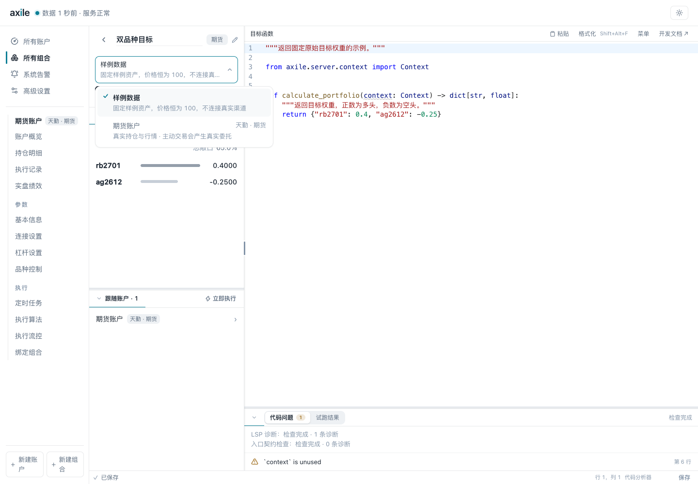
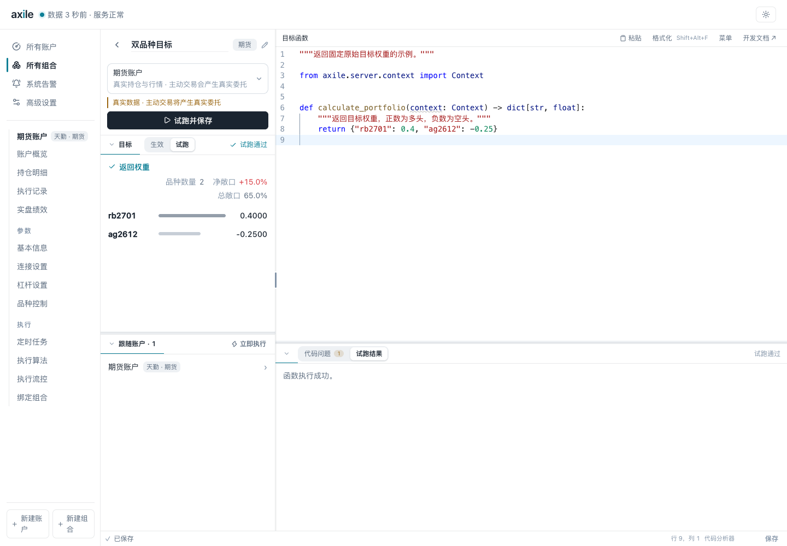
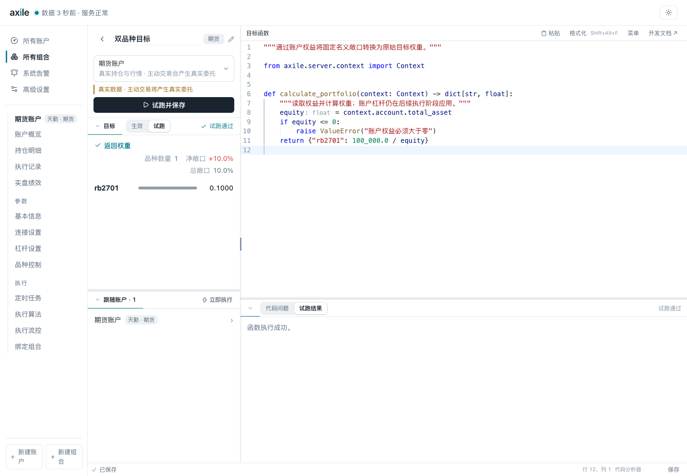
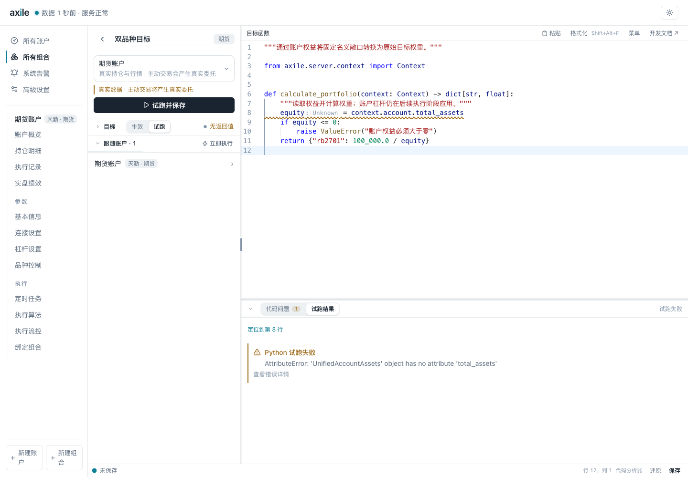

# 05 · 编写自定义组合函数

重新计算目标时，Axile 会调用组合函数，取得各品种的原始目标权重。先用固定权重试跑，确认结果后再加入账户查询或自己的信号。

## 第一步：只返回固定权重

<<< ../examples/fixed_weights.py

这个函数只有一个参数 `context`，返回 Python 字典。正数代表多头，负数代表空头，`{}` 代表目标空仓。这里的数字是完整目标，不是在现有持仓上的增量。

字典的键必须是字符串，值必须是有限数字，不能用布尔值。标的代码格式由交易渠道决定，可以先沿用市场模板，再换成实际合约。

## 第二步：选择试跑数据来源

组合编辑器可以使用样例数据，也可以选择一个账户。

| 项目 | 样例数据 | 账户上下文 |
| --- | --- | --- |
| 账户与持仓 | 固定样例资产，持仓为空 | 当前账户资产与持仓 |
| 行情 | 任意标的价格为 100 | 当前渠道行情 |
| 运行位置 | 一次性子进程 | 账户常驻 Worker |
| 完整 executor | 仅提供样例通用查询 | 当前账户的完整渠道执行器 |

::: warning 真实账户试跑的边界
试跑时，Axile 不会自动执行函数返回的目标。但函数内调用 `context.executor` 的交易方法，仍会产生真实委托。初次编写时，只查询数据并返回权重即可。
:::

选择账户，用同一个固定函数再次试跑，查看数据来源提示和返回结果。

账户上下文读取所选账户的数据，使用前先确认账户名称。

## 第三步：读取账户权益

要把十万元名义敞口换成原始目标权重，可以除以账户权益：

<<< ../examples/equity_to_weight.py

账户权益为一百万元时，函数返回 `0.1`。示例会检查权益是否为正数，避免无效除法。执行时还会应用账户杠杆，计算实际敞口时也要计入杠杆。

## 第四步：接入自己的信号

研究程序已经输出目标权重时，可以让组合函数读取 CSV 文件。在 Axile 运行目录放置 `signals/target_weights.csv`：

<<< ../examples/target_weights.csv{csv}

组合函数读取这份文件：

<<< ../examples/csv_weights.py

示例会拒绝空文件、重复品种和非有限数字。数据缺失时如何处理，需要在函数中明确：直接返回 `{}` 表示目标空仓。文件路径相对服务的运行目录，样例试跑和账户 Worker 都要能读到它。

外部数据的时间、字段和品种格式也需要检查。先用样例数据验证返回值，再选择账户，核对实际数据。

## 怎样定位错误

截图中故意把 `total_asset` 写成 `total_assets`。试跑面板显示 `AttributeError`，并提供“定位到第 8 行”。

先看错误类型和行号，需要更多信息时再展开 traceback。把字段改回正确名称，重新试跑，检查返回值后保存。使用账户数据试跑后，若提示会话未就绪，先回到账户概览确认连接，再试跑。编辑器的代码提示、试跑结果和保存状态要分开看。

| 现象 | 优先检查 |
| --- | --- |
| SyntaxError | 缩进、括号和函数定义 |
| AttributeError / KeyError | 字段名称、上下文类型、可选字段是否存在 |
| 返回值校验失败 | 是否为字典；品种键、有限数字和布尔值 |
| 样例成功、账户失败 | 真实数据是否可用；渠道能力和依赖是否不同 |
| 执行超时 | 数据查询和外部请求是否有边界；单次函数运行预算 |

## 什么时候会调用函数

点击试跑、刷新目标、在设置向导中预览目标，以及调仓开始前计算目标，都会调用函数。普通页面读取只显示最近一次成功保存的目标快照。

Context 会在一次调用内缓存账户资产和已查询的行情。缓存只用于本次调用，不能当作跨执行的实时状态。对常驻 executor 的修改则可能留到后续调用。

完整接口、方向参数和高级 executor 边界见 [Context 查询参考](/reference/context)。
