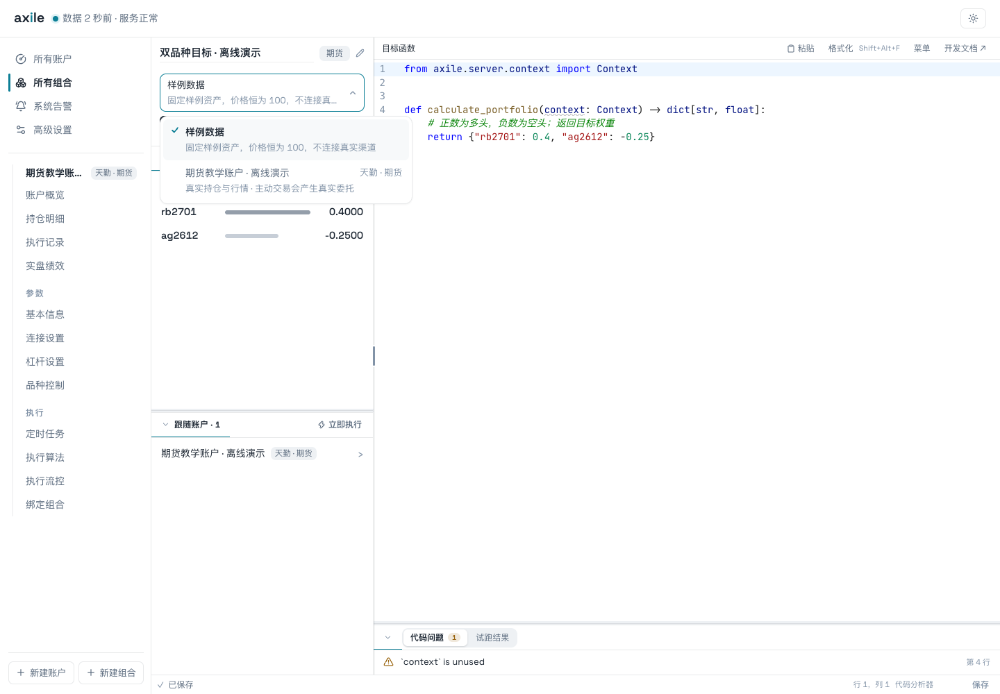
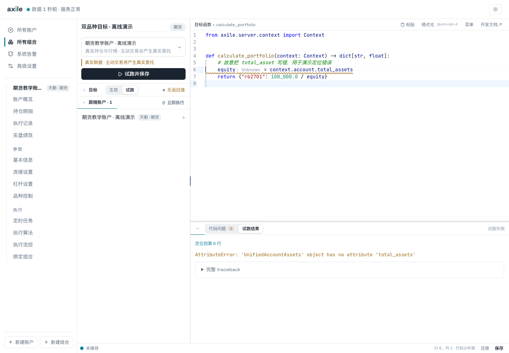

# 05 · 编写自定义组合函数

组合函数在需要重新计算目标时运行，返回一份“品种 → 原始目标权重”。建议先把固定权重跑通，再逐步加入账户查询和你自己的信号来源。

## 第一步：只返回固定权重

<<< ../../guide-materials/05-functions/examples/fixed_weights.py

这个函数只有一个参数 `context`，返回 Python 字典。正数代表多头，负数代表空头，`{}` 代表目标空仓。这里的数字是完整目标，不是在现有持仓上的增量。

键必须是字符串，值必须是有限数字，布尔值不算数字。标的代码格式由交易渠道决定；先沿用该市场生成的模板，再替换成自己的实际合约。

## 第二步：选择试跑数据来源

组合编辑器可以使用样例数据，也可以选择一个账户。

| 项目 | 样例数据 | 账户上下文 |
| --- | --- | --- |
| 账户与持仓 | 固定样例资产，持仓为空 | 当前账户资产与持仓 |
| 行情 | 任意标的价格为 100 | 当前渠道行情 |
| 运行位置 | 一次性子进程 | 账户常驻 Worker |
| 完整 executor | 仅提供样例通用查询 | 当前账户的完整渠道执行器 |

::: warning 真实账户试跑的边界
“试跑”表示 Axile 不会自动执行函数返回的目标。如果函数主动调用 `context.executor` 的交易方法，仍会产生真实委托。入门函数应使用查询能力并返回权重。
:::

选择教学账户后，使用同一个固定函数再次试跑，观察数据来源提示和返回结果。

图中的账户上下文来自离线替身；真实使用时，这一选项连接的是你选择的账户。

## 第三步：读取账户权益

假设想表达十万元名义敞口，可以先除以账户权益，换成原始目标权重：

<<< ../../guide-materials/05-functions/examples/equity_to_weight.py

在一百万元教学权益下返回 `0.1`。函数检查非正权益，避免无效除法。账户杠杆仍会在后续执行阶段应用，因此实际敞口要结合杠杆核对。

## 第四步：接入自己的信号

如果上游研究程序已经输出目标权重，可以先用 CSV 把两者连起来。例如，在 Axile 的运行目录放置 `signals/target_weights.csv`：

<<< ../../guide-materials/05-functions/examples/target_weights.csv{csv}

组合函数读取这份文件：

<<< ../../guide-materials/05-functions/examples/csv_weights.py

这里明确拒绝空文件、重复品种和非有限数字。缺少信号时直接返回 `{}` 会表达空仓目标，应根据自己的业务语义决定如何处理数据缺失。文件路径相对服务运行目录；样例试跑和账户 Worker 都要能够访问它。

接入外部数据后，还应在自己的函数中检查数据时间、字段和品种格式。先在样例环境验证返回值，再用账户上下文核对实际数据。

## 怎样定位错误

截图中故意把 `total_asset` 写成 `total_assets`。试跑面板显示 `AttributeError`，并提供“定位到第 6 行”。

排查时先看错误类型和行号，再展开 traceback。把字段改回正确名称，重新试跑，确认返回值之后再保存。代码提示、运行失败和保存状态是不同信息。

| 现象 | 优先检查 |
| --- | --- |
| SyntaxError | 缩进、括号和函数定义 |
| AttributeError / KeyError | 字段名称、上下文类型、可选字段是否存在 |
| 返回值校验失败 | 是否为字典；品种键、有限数字和布尔值 |
| 样例成功、账户失败 | 真实数据是否可用；渠道能力和依赖是否不同 |
| 执行超时 | 数据查询和外部请求是否有边界；单次函数运行预算 |

## 什么时候会调用函数

点击试跑、显式刷新目标、设置流程中预览组合目标，以及真实调仓开始前计算本次目标时，会调用函数。普通页面读取只展示最近一次成功保存的目标快照。

同一次调用内，Context 缓存账户资产和已查询行情。不要把这份缓存当作跨执行的实时状态；高级代码对常驻 executor 的修改也可能留到后续调用。

完整接口、方向参数和高级 executor 边界见 [Context 查询参考](/reference/context)。
