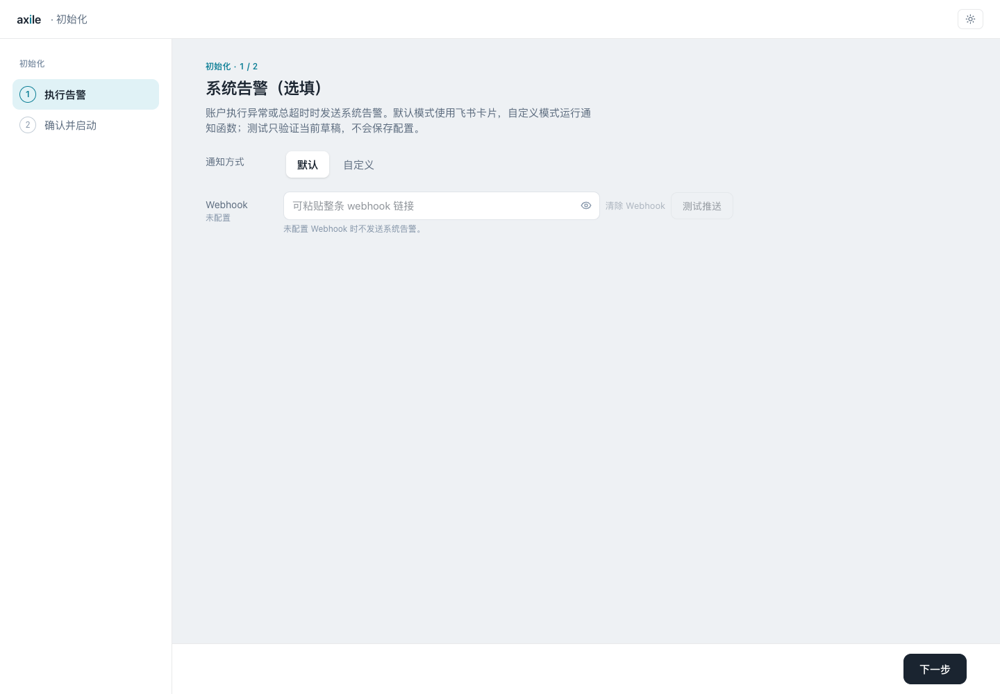
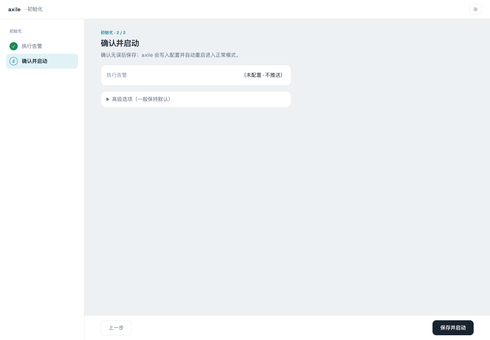
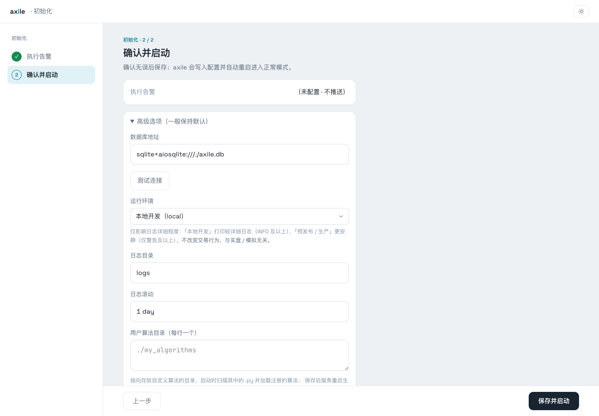
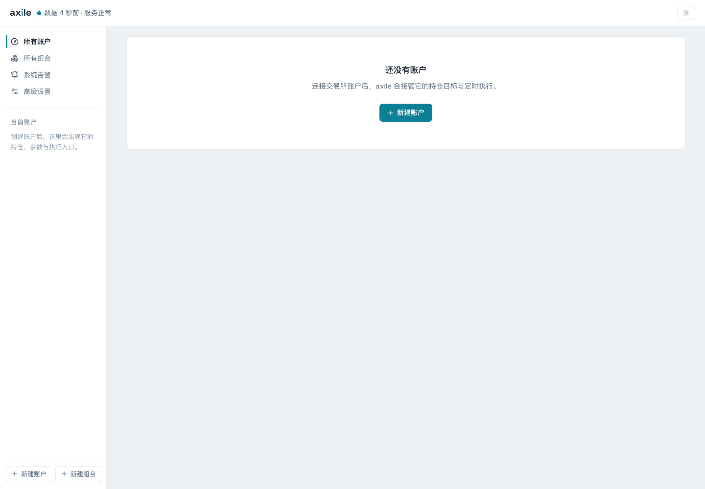

# 02 · 安装与启动

下面按源码方式安装 Axile 公共版。首次启动并完成初始化后，控制台为空，可以开始创建账户和组合。

## 准备环境

需要 Python **3.12 或以上**、[uv](https://docs.astral.sh/uv/)、[Bun](https://bun.sh/)、Rust 和 C 编译环境。Rust 版本由仓库的 `rust-toolchain.toml` 固定，Bun 用于构建管理界面。

克隆公共仓库：

```bash
git clone https://github.com/zengbin93/axile.git
cd axile
```

先构建并校验原生存储扩展，构建目录放在工作树之外：

```bash
export CARGO_TARGET_DIR="${TMPDIR:-/tmp}/axile-native-target"
uv run --no-project --with hatchling --with packaging python \
  scripts/build_native_analysis.py --target-dir "$CARGO_TARGET_DIR"
```

然后安装所用渠道的依赖。本指南使用天勤：

```bash
uv sync --extra tqsdk
```

其他渠道的安装方式和平台差异见[渠道与配置](/reference/channels)。

## 构建管理界面

```bash
cd ui
bun install --frozen-lockfile
bun run build
cd ..
```

Axile 后端会托管构建好的界面，启动后端即可访问。

## 启动服务

在 Axile 仓库根目录运行：

```bash
uv run axile --host 127.0.0.1 --port 8000
```

打开 `http://127.0.0.1:8000`。首次未生成 `config.toml` 时，会进入初始化向导。

::: tip 运行目录
配置文件和默认 SQLite 数据库都保存在服务的运行目录下。请从同一个目录启动，否则可能读到另一份数据库，看不到之前的账户。服务仅允许监听回环地址。
:::

## 完成首次初始化

### 1. 选择系统告警方式

账户执行异常、总超时或触发额度预警时，可以发送系统告警。这项选填，暂时留空也可以，之后在“系统告警”中配置。



<p class="caption">未配置 Webhook 时不推送消息。这里可以直接进入下一步。</p>

### 2. 确认配置

核对设置后点击“保存并启动”。初始化会写出配置文件。



### 3. 按需查看高级选项

数据库、日志和算法目录有默认值，通常可以直接沿用。运行环境 `local`、`staging`、`production` 控制日志详细程度；账户是否实盘或模拟，在账户连接设置中选择。



::: info 保存后再次启动
保存初始化配置后，服务进程会退出，由外部 supervisor 重启。如果直接用上面的命令启动，需要再运行一次 `uv run axile ...`，然后刷新浏览器。
:::

## 确认进入控制台

启动完成后会看到空控制台。顶部显示服务正常，页面提示尚无账户。



下一步[创建第一个组合](/guide/first-portfolio)。

## 升级已有安装

升级前停止旧服务并备份数据库。启动新版时，Rust 存储扩展会执行数据库迁移；公共核心、渠道插件和界面应使用匹配版本。迁移失败时先保留错误及备份，不能通过手改版本号跳过迁移。降级可能因新数据无法无损转换而被拒绝，需要回退时使用升级前备份。
