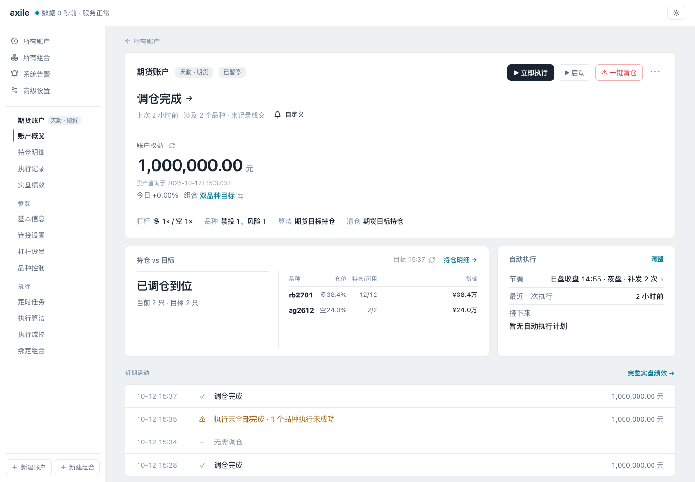

# 01 · 认识 Axile

把交易信号写成组合函数，给出各品种的目标权重后，Axile 负责连接账户、换算数量、安排调仓，并记录执行结果。

本指南面向了解多空、权重、持仓和调仓的读者。Python 部分从一个简单的组合函数开始，不要求先读执行器源码。

## 先理解三个对象

| 对象 | 负责什么 | 在哪里操作 |
| --- | --- | --- |
| 组合 | 保存目标计算函数，计算各品种的原始目标权重 | 所有组合 → 组合编辑器 |
| 账户 | 保存渠道连接、绑定组合、杠杆、算法和运行节奏 | 所有账户 → 账户设置 |
| 一次执行 | 计算本次目标、管理订单，并记录实际结果 | 账户概览 → 立即执行 / 执行记录 |

多个账户可以跟随同一个组合，各自使用自己的资金和执行设置。组合函数给出目标权重，Axile 再按账户杠杆、精度和交易单位换算持仓数量。

## 控制台：从账户开始

首页集中显示已有账户和服务状态，需要处理的账户也会在这里提示。尚无账户时，页面会提示创建。

图中有一个账户。侧栏可以切换账户、查看组合，也可以新建账户或组合。

## 账户概览：目标与实际放在一起

账户概览里有权益、绑定的组合、杠杆和算法设置，也列出当前持仓与目标。自动执行安排和近期活动在页面下方。

“已调仓到位”表示持仓达到可执行目标。具体的数量依据、订单终态和成交记录在执行详情中查看。

## 组合：你自己的目标函数

进入“所有组合”，查看各组合及其跟随账户。打开组合后，在 Python 编辑器中编写 `calculate_portfolio(context)`，试跑并检查返回值。

## 本指南的贯穿例子

本指南使用同一个期货组合：函数返回 `{"rb2701": 0.4, "ag2612": -0.25}`，账户权益为 100 万元，多空杠杆均为 1。后续章节用这组数值计算目标手数，比较调仓前后的持仓。

这组数据仅用于讲解接口与界面。合约代码、价格和配置都需要根据实际渠道替换。

首次使用请按[安装与启动](/guide/install)、[创建第一个组合](/guide/first-portfolio)的顺序操作。
