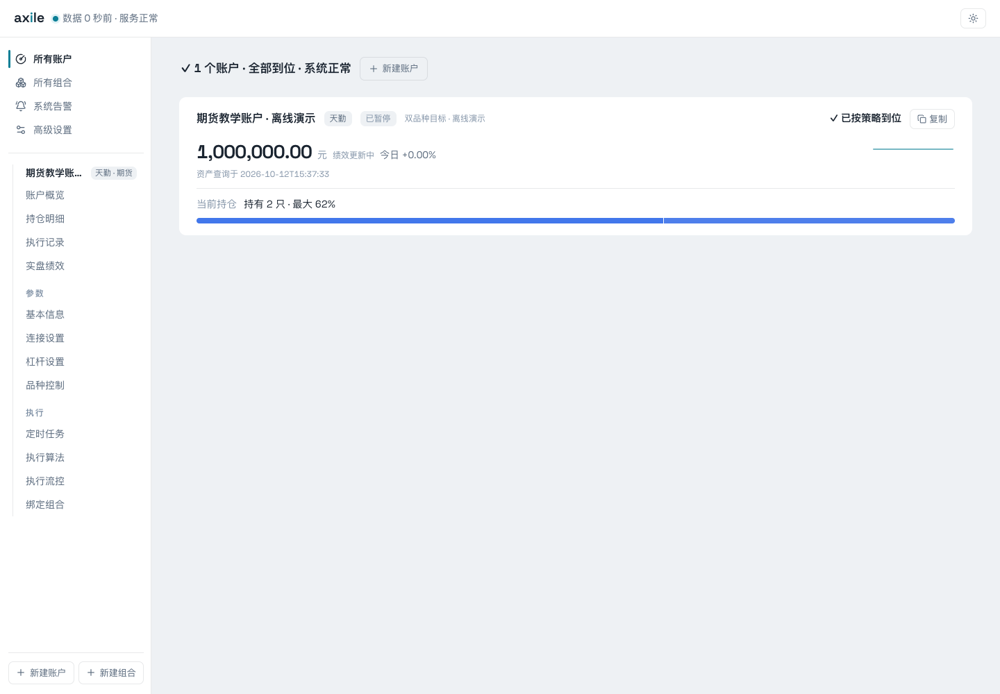
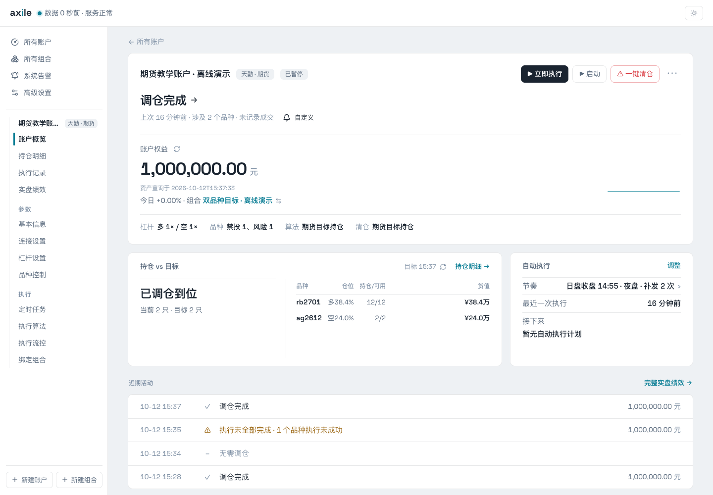
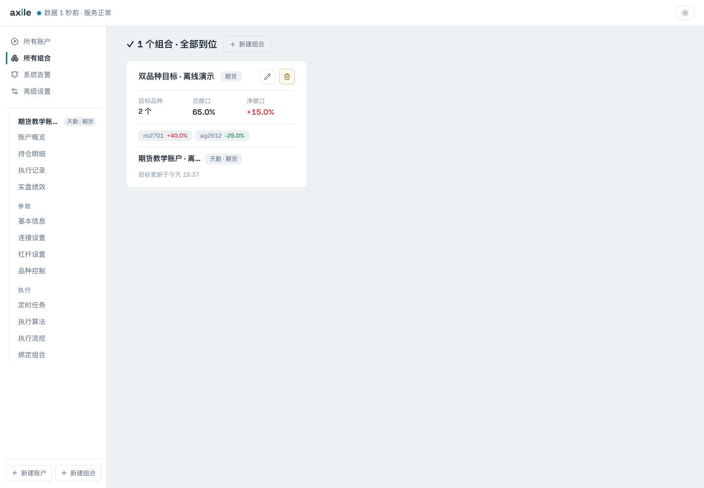

# 01 · 认识 Axile

你已经有了一份交易信号，知道每个品种想持有多少。Axile 接下来处理账户连接、目标换算、执行调度和结果核对，让这份目标进入账户的实际交易流程。

本指南默认你理解多空、权重、持仓和调仓。Python 接口从最小例子开始；不需要先读完所有执行器源码。

## 先理解三个对象

| 对象 | 负责什么 | 在哪里操作 |
| --- | --- | --- |
| 组合 | 保存目标计算函数，计算各品种的原始目标权重 | 所有组合 → 组合编辑器 |
| 账户 | 保存渠道连接、绑定组合、杠杆、算法和运行节奏 | 所有账户 → 账户设置 |
| 一次执行 | 计算本次目标、管理订单，并记录实际结果 | 账户概览 → 立即执行 / 执行记录 |

同一个组合可以供多个账户跟随，各账户使用自己的资金和执行设置。组合函数返回的是目标仓位；系统随后还会处理账户杠杆、精度和可交易数量。

## 控制台：从账户开始

打开首页，先看服务状态和需要关注的账户，再进入具体账户。尚未创建账户时，页面会提示创建；已有账户会集中显示在这里。

示例中只有一个离线教学账户。所有账户、所有组合和新建入口都在侧栏。

## 账户概览：目标与实际放在一起

账户概览展示权益、绑定组合、杠杆与算法，以及当前持仓和目标的对照。页面下方可以查看自动执行安排和近期活动。

看到“已调仓到位”后，仍可进入执行详情查看数量依据、订单终态和成交记录。

## 组合：你自己的目标函数

进入“所有组合”，查看各组合及其跟随账户。打开组合后，在 Python 编辑器中编写 `calculate_portfolio(context)`，试跑并检查返回值。

## 本指南的贯穿例子

我们创建一个期货组合，返回 `{"rb2701": 0.4, "ag2612": -0.25}`。教学账户权益为 100 万元，多空杠杆均设为 1，再观察目标怎样变成手数，以及执行前后持仓怎样变化。

这组数据仅用于讲解接口与界面。合约代码、价格和配置都需要根据实际渠道替换。截图来源与验证范围见[演示数据说明](/reference/screenshots)。

接下来完成[安装与启动](/guide/install)，再[创建第一个组合](/guide/first-portfolio)。
