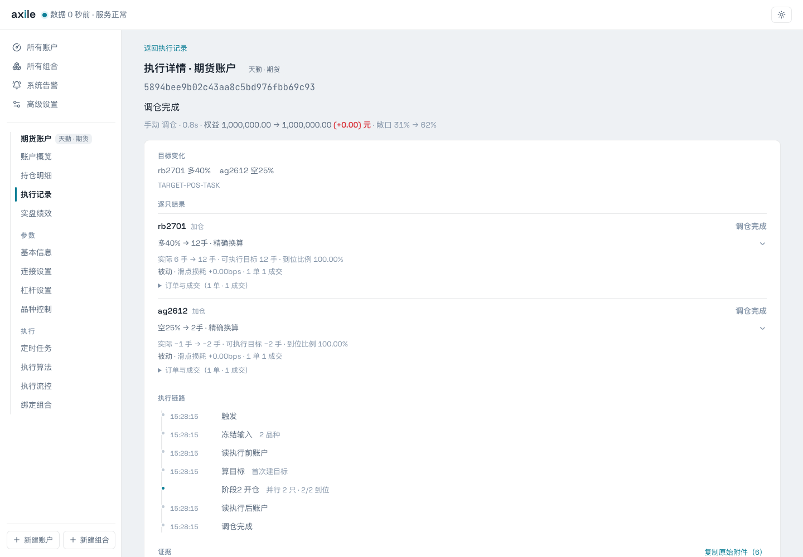
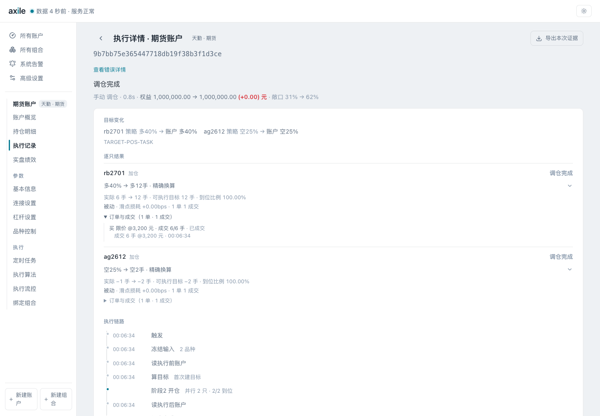
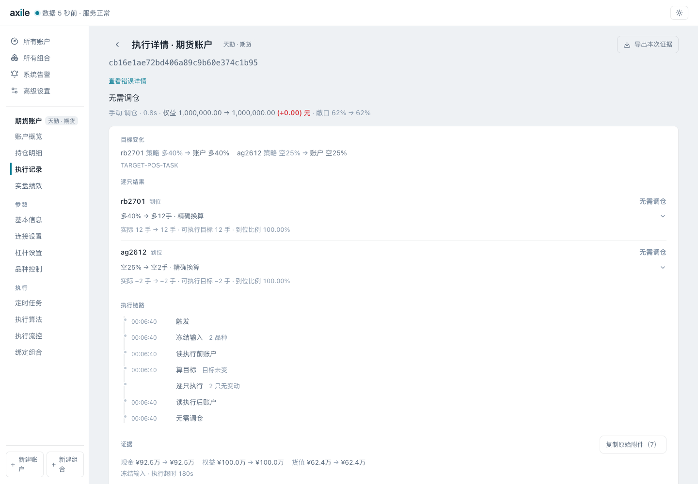
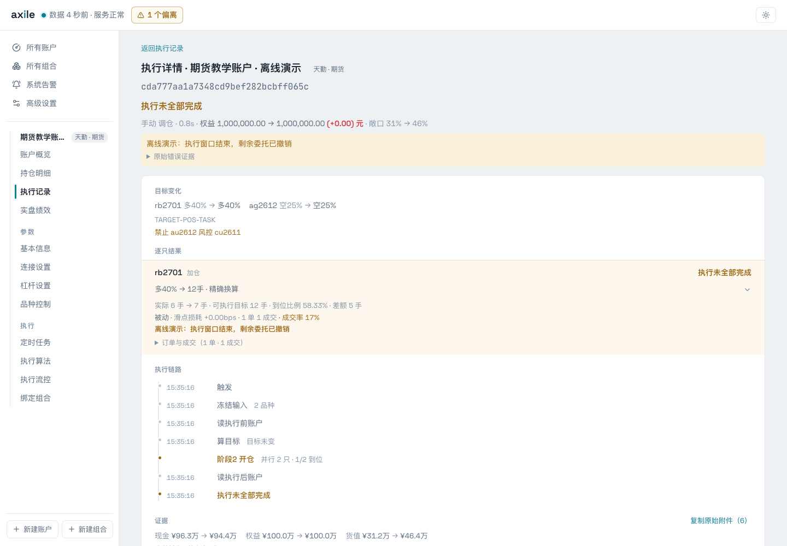
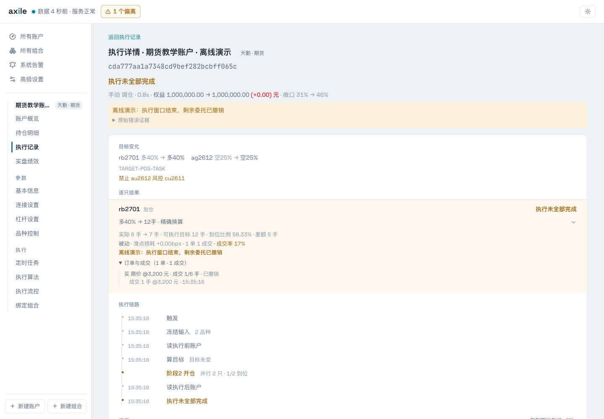
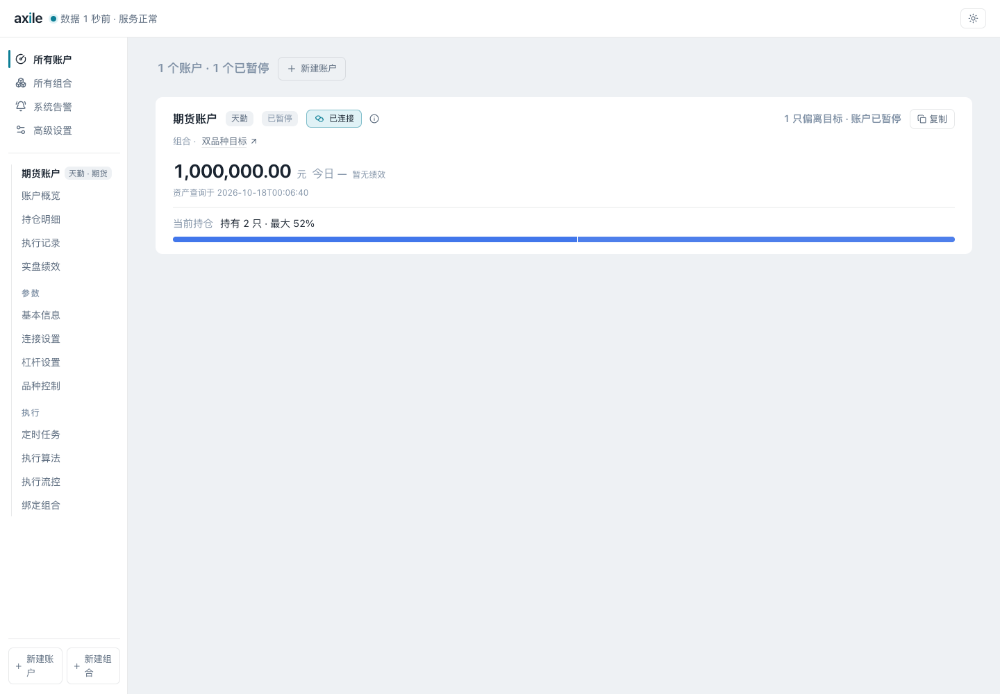
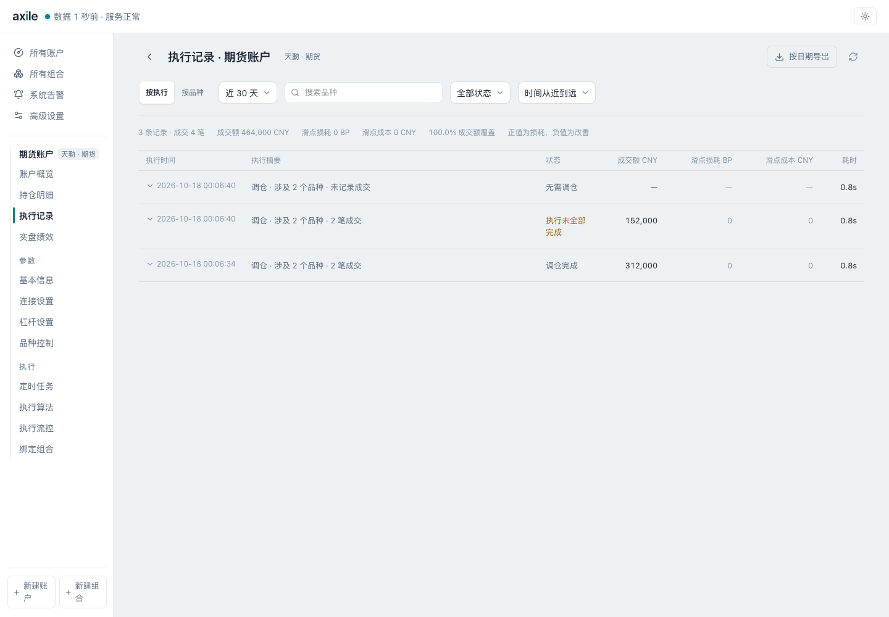
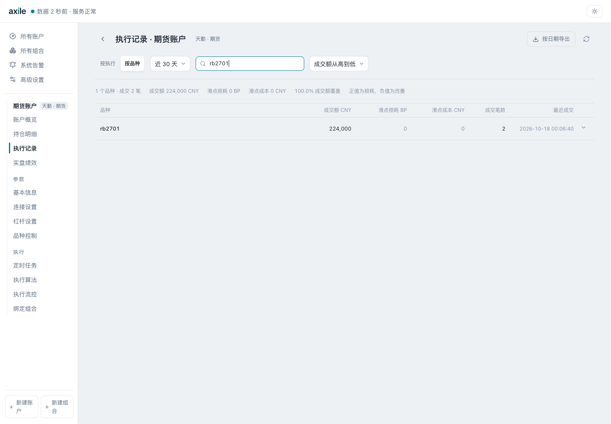
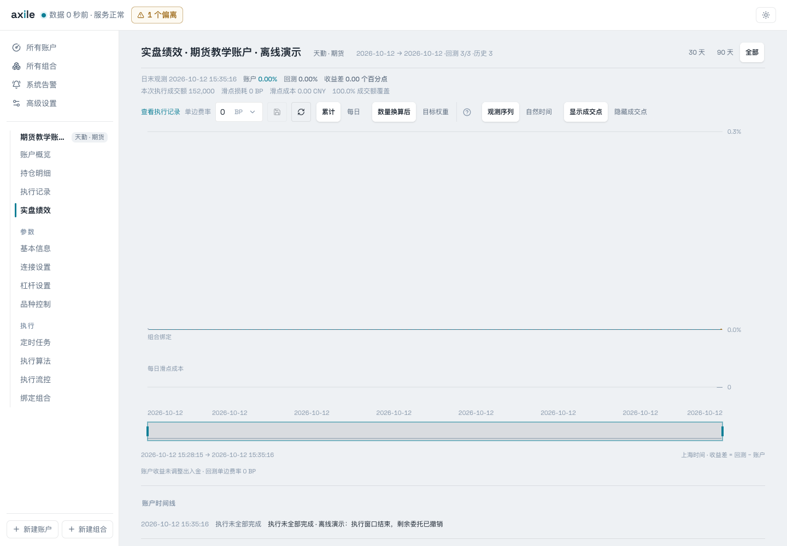
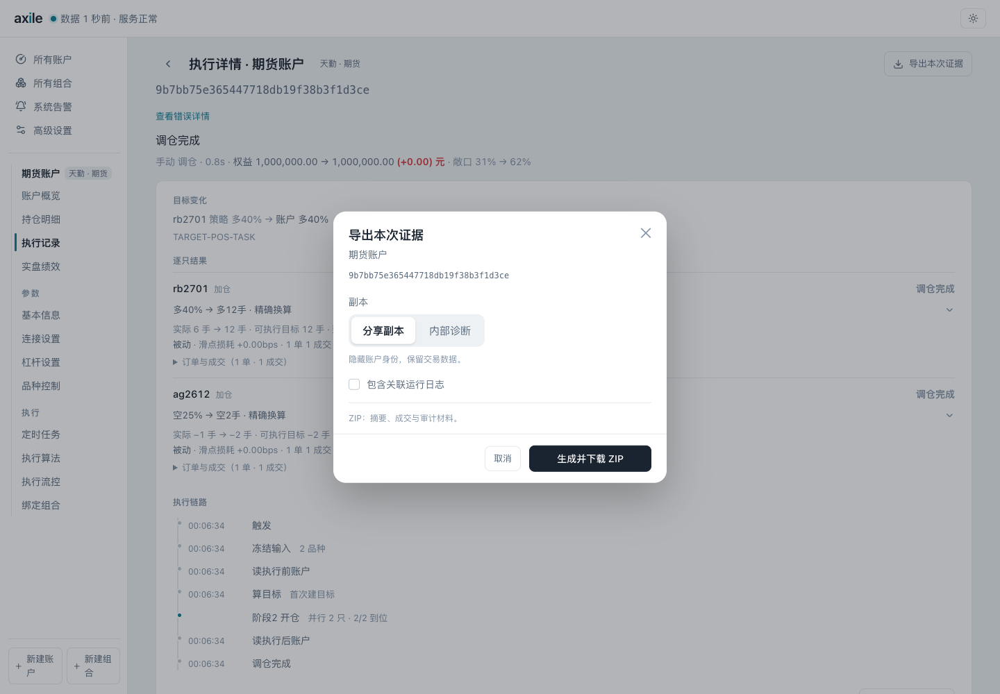

# 08 · 查看执行结果与排错

执行结束后，先看账户结论，再按品种检查目标、实际持仓、订单终态和成交。执行是否结束、持仓是否到位，要分别确认。

::: info 本页场景
本页的完整成交、无需调仓和部分成交均使用示例数据。收益、耗时和滑点只用于解释界面。
:::

## 完整成交：先看逐品种结果

本次调仓把 rb2701 从多 6 手调到多 12 手，ag2612 从空 1 手调到空 2 手。结果页列出账户结论、逐品种的目标和实际持仓，以及执行过程。

## 展开订单与成交

展开品种下的“订单与成交”，查看委托数量、已成交数量、成交明细和订单终态。

委托数量和实际成交数量要分别查看。状态标题没有包含全部订单细节。

## 无需调仓：没有新成交也可以正常

本例没有产生新的成交，结果为“无需调仓”，表示持仓已经达到本次可执行目标。这个结果与执行失败或没有收到结果的情况不同。

## 部分成交：核对剩余缺口

下面这次执行中，rb2701 的目标仍为多 12 手，只从 6 手增加到 7 手，还差 5 手。ag2612 已完成，账户结论显示“执行未全部完成”。

| 指标 | 本例含义 | 数字 |
| --- | --- | ---: |
| 到位比例 | 当前实际持仓 / 可执行目标 | 7 / 12 = 58.33% |
| 本轮委托成交率 | 本轮成交数量 / 本轮委托数量 | 1 / 6，约 17% |
| 剩余缺口 | 可执行目标 − 当前实际持仓 | 5 手 |

展开订单，能同时看到成交 1 手和剩余委托已撤销。

本例中，执行窗口结束后撤销剩余委托。排查时应结合实际原因和订单终态。

## 休市跳过与终止

交易时段关闭时，品种可能显示跳过。全部品种因休市跳过，与部分品种完成、部分品种休市的情况要分开看。若已有订单、成交或真实错误，还要继续核对这些记录，不能只凭休市原因判断整次执行正常。

手动终止或执行总超时后，检查剩余委托是否已撤销、最终持仓是否已确认。任务结束不等于所有委托都已确认终态。连接中断或撤单结果未知时，先在[当日委托与成交](/guide/activity)中核对，再决定是否重新执行。

## 从总览发现需要关注的账户

控制台会提示持仓偏离的账户，点击账户可查看详情。

## 在执行记录中缩小范围

选择“按执行”可查看每次任务的结论和成交规模。要追踪某个品种，切到“按品种”，再输入品种代码搜索。

## 查看绩效与执行时间线

绩效页面显示账户收益、组合回测结果、成交点和异常时间线。回测可选择数量换算后的目标或原始目标权重；时间轴可选择观测序列或自然时间。

两种回测都从共同基准资金建立独立的模拟权益账本，先结算每段盈亏，再根据模拟权益计算日收益和累计收益。数量换算后的回测按历史目标手数回放；原始目标权重回测在每个有效观测点，按自身模拟权益调整敞口。目标手数来自当时的实盘规划，因此数量回放用于评估这组历史目标的理论结果，不是重新生成一套独立策略信号，也不表示这些目标均已实际成交。

基准点视为已建仓，不扣基准前建仓费用；之后按配置费率对加减仓、反手、换月及清仓的双边名义成交额计费。缺少完整手数换算证据时，整条观测回退到原始目标权重，并标记回退区间；缺目标或行情的观测会跳过，持仓延续，恢复观测时结算跨缺口盈亏。缺口内延续值不代表已获取当时市值。

实盘与理论收益的差额还可能包含成交价格、执行时延、未完成调仓、实际费用和采样时差，不能全部解释为滑点。实盘权益收益目前未剔除出入金，期间有资金变动时需另行核对。

本例展示同一天的观测数据，曲线与成本用于解释界面。评价策略表现需要足够长的实际数据。

### 查看品种贡献

账户曲线下方显示品种贡献排名和累计贡献曲线。排名包含已经清仓的合约；天勤和 CTP 的期货合约在交易所、品种代码一致时合并月份，展开可查看各合约。勾选排名中的品种可对比曲线，窄屏下排名和曲线上下排列。

在账户曲线上框选区间，贡献曲线从该区间起点归零，排名同步更新。“分析这段回撤”选择当前范围内账户权益从高点到最低点的一段，便于查看哪些品种造成亏损、哪些抵消了亏损。回撤按现有权益观测计算，不代表逐笔行情下的日内最大回撤。

毛盈亏按区间卖出金额减买入金额，再加期末带方向持仓价值、减期初带方向持仓价值计算；多头取正，空头取负，成交金额使用留存的合约乘数和金额换算依据。计算边界与账户曲线使用同一份快照、同一组观测，不把基准前的交易盈亏重复计入。曲线是采样观测结果，不是柜台结算单。

手续费完整时才显示净盈亏；缺少手续费时保留毛盈亏并标明未知笔数，不使用回测费率代替。成交与持仓不符、估值或乘数缺失时显示待核对或断线，不自动补造历史成交。“未归因差额”保留权益变化与已知品种毛盈亏、已知手续费之间的差异，可能包含出入金、未知费用、分红、资金费和缺失记录。滑点已经体现在成交价中，不再重复扣除。

## 导出排查材料

单次执行详情中的“导出本次证据”用于保存这次任务的材料。执行仍在进行时，证据包会标明采集时刻和未确认事项。

在支持账户批量导出的页面，点击“按日期导出”，选择北京时间的起止日期，包含首尾，最多 31 天。导出的是完整执行，不受页面的品种筛选影响。

“分享副本”隐藏账户身份，仍保留交易数据；“内部诊断”保留名称和诊断信息，排除凭据与代码。可按需包含关联运行日志。分享前仍应检查交易数据是否适合提供给接收方。

单包最多 100 个交易执行，独立账户操作另列；超过数量、大小或生成时间限制时，需缩小范围后重试。ZIP 中的 `manifest.json` 记录采集时间、选择范围、材料缺口及文件校验值，CSV 和摘要是由留存事实生成的视图。“已发起下载”只表示文件已交给浏览器，不表示已保存到磁盘。

证据包保存的是当时可获取的材料。缺失或未确认项需要继续核对，不能用一次导出替代渠道状态检查。

## 实际排查顺序

1. 看账户结论：无需调仓、部分完成、受阻、失败或终止。
2. 找到受影响品种，核对账户目标与可执行数量。
3. 比较执行前后实际持仓，计算剩余缺口。
4. 展开订单终态、成交数量和成交明细。
5. 查看执行链路、错误原因和原始附件，再决定后续动作。

如果账户概览摘要与详情不一致，应以执行详情中留存的订单和成交证据继续核对。
