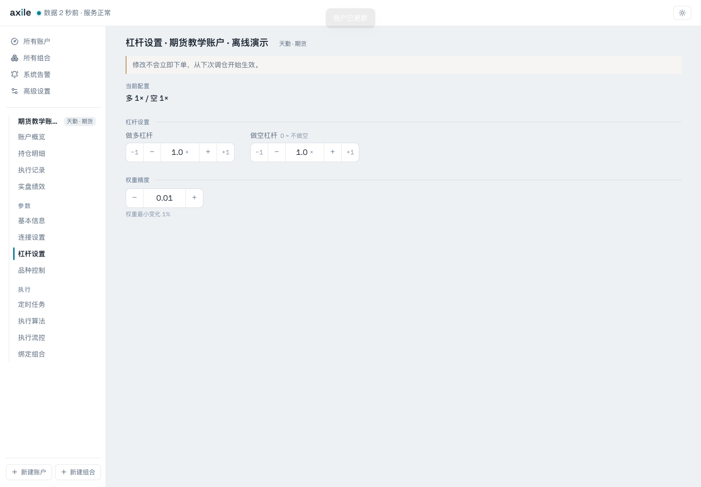
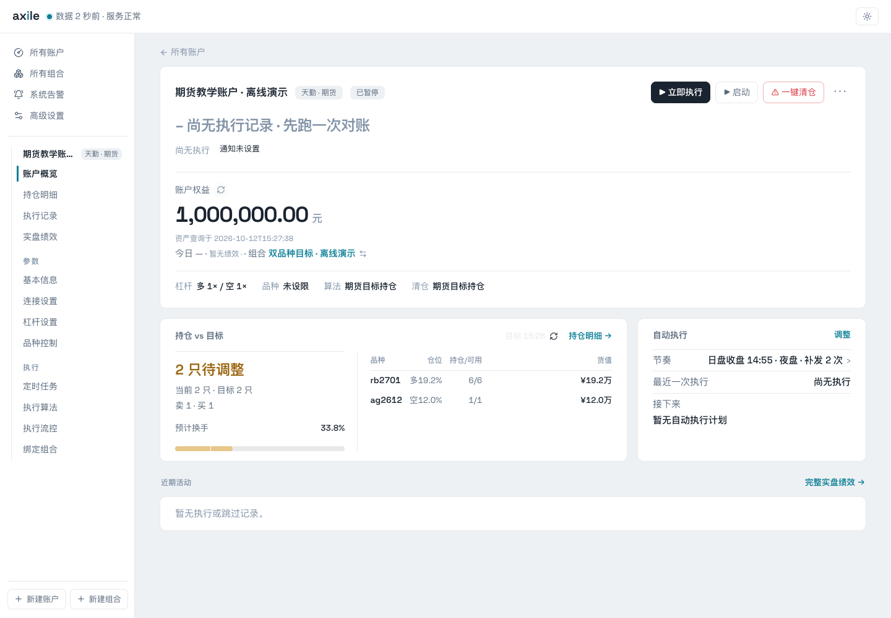
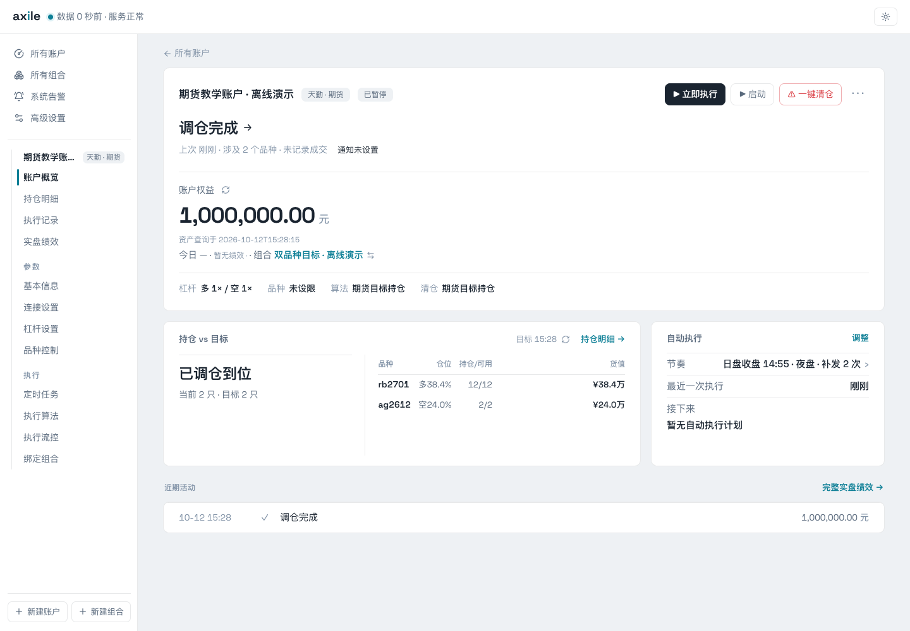
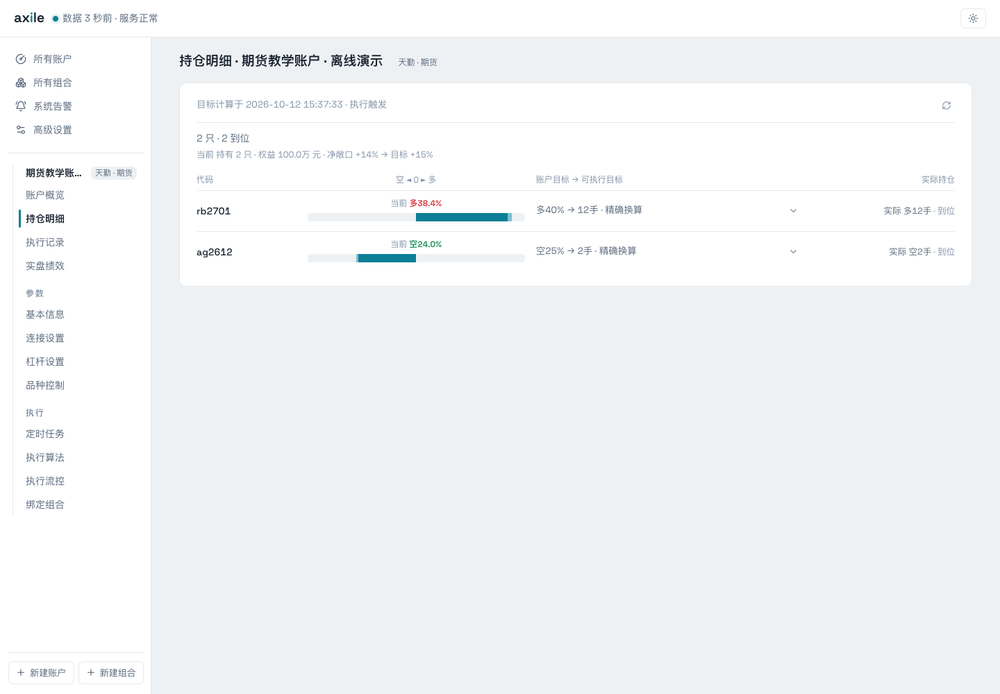

# 04 · 理解目标与持仓

函数返回 rb2701 的目标权重 40%，执行后却显示多 12 手、38.4% 的持仓，并标记到位。这是怎么回事？

关键是区分**原始目标权重、账户目标权重和可执行数量**。

## 三层目标

| 层次 | 含义 | 例子 |
| --- | --- | --- |
| 原始目标权重 | 组合函数直接返回的值 | rb2701 为 0.4 |
| 账户目标权重 | 应用账户杠杆和精度后的目标 | 本例多头杠杆为 1，仍为 0.4 |
| 可执行目标 | 结合权益、价格、合约乘数和数量规则得到的持仓 | 多 12 手 |

这里的期货权重按名义敞口相对账户权益解释。名义敞口与保证金占用是不同口径。

## 先核对杠杆

在账户“杠杆设置”中分别配置多头和空头。本例把向导默认的 3 改成 1，权重精度为 0.01。



<p class="caption">保存配置不会立即下单，从下次调仓开始生效。</p>

## 把权重换成手数

本例权益为 1,000,000 元。教学行情中，rb2701 价格为 3,200，乘数为 10；ag2612 价格为 8,000，乘数为 15。

```text
目标名义价值 = 账户权益 × 账户目标权重
每手名义价值 = 参考价格 × 合约乘数
未取整目标数量 = 目标名义价值 ÷ 每手名义价值
```

| 品种 | 账户目标 | 每手名义价值 | 未取整数量 | 可执行目标 |
| --- | ---: | ---: | ---: | ---: |
| rb2701 | 40% | 3,200 × 10 = 32,000 元 | 12.5 手 | 多 12 手 |
| ag2612 | -25% | 8,000 × 15 = 120,000 元 | -2.0833 手 | 空 2 手 |

国内期货数量按整手向零截断。在执行详情中，展开品种目标即可看到换算依据。


<p class="caption">“精确换算”表示有足够的权益与行情依据，并不表示没有取整；这里仍从 12.5 手截成 12 手。</p>

## 比较执行前后

执行前，教学账户持有 rb2701 多 6 手、ag2612 空 1 手，两个品种都需要调整。



执行后，持仓达到多 12 手、空 2 手：



rb2701 的实际名义敞口为 `12 × 3,200 × 10 = 384,000` 元，占权益 38.4%。ag2612 的实际空头名义敞口为 240,000 元，占权益 24.0%。它们与原始百分比有差异，但已达到可执行整数手目标。

## 在持仓明细中核对

“持仓明细”同时展示账户目标、可执行目标和实际持仓。排查偏离时，先核对这三列，再看订单和成交。



::: tip 不只看百分比
价格、权益、账户精度和交易单位都会影响目标。目标与持仓百分比不完全相等时，先查看数量依据；显示到位也不等于每一笔订单都已妥善收尾，仍需结合[执行结果](/guide/results)。
:::
