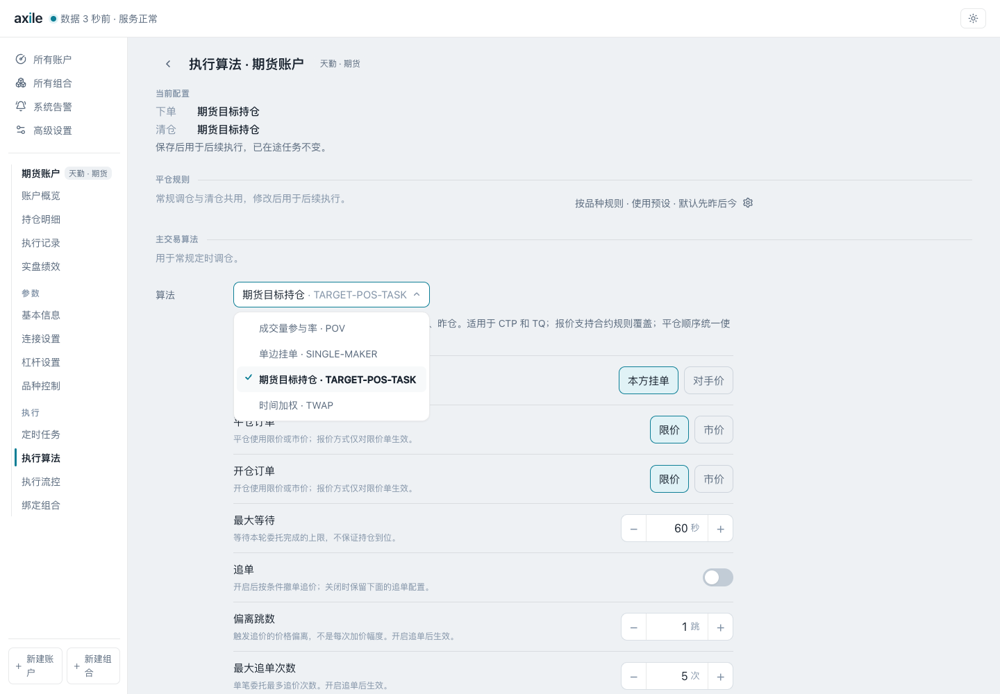

# 执行算法

组合函数返回原始目标权重，执行层将它换算为可执行数量。下单算法负责处理目标持仓与当前持仓之间的差量，主交易和清仓可以分别配置算法。

## 当前公共算法目录



| 算法 | 用途 | 需要理解的边界 |
| --- | --- | --- |
| TARGET-POS-TASK | 期货目标持仓，适用于 CTP 与天勤 | 开平仓顺序、报价、等待与追单 |
| SINGLE-MAKER | 单边挂单，可按条件撤单追价 | 主动报价仍可能留下剩量 |
| TWAP | 按时间安排拆单 | 前片欠量滚入后片，计划时长不是严格截止时间 |
| POV | 按收到的增量成交量与参与率跟单 | 无量等待；到期补单可能不再受参与率约束 |
| CTP_OPTION_EXERCISE | CTP 期权行权、放弃或自对冲指令 | 独立指令用途，不用于账户主交易或清仓槽位 |

期货平仓顺序在账户级[平仓规则](/guide/daily#配置期货平仓规则)中设置，常规调仓和清仓共用。

下拉框只列出适用于当前渠道、主交易或清仓槽位的算法。其他算法仍可能存在于代码库中。

## 同一账户按时段选择算法

在账户的执行算法设置中，左侧选择默认算法、指定时段或清仓算法，右侧复用算法参数编辑器。
点击“添加时段”后，在右侧顶部选择开始、结束时间，再设置算法和参数。切换配置保留草稿，底部统一保存或取消；时段列表和参数区分别滚动。

- 时段按北京时间每天重复，开始时刻包含、结束时刻不包含。例如 `09:30–10:00` 在 `10:00` 已不生效。
- 结束早于开始表示跨午夜，界面标为“次日”，例如 `21:00–次日 02:30`。时段不能重叠，首尾相接允许。
- 未命中时段时使用默认算法的配置。相同算法也可以在不同时段使用不同参数。
- 手动调仓、定时调仓和补发共用这套选择规则。每次在开跑前选定一次完整配置，执行期间跨过时段边界也不会切换。
- 修改配置影响后续执行。排队中的任务在开跑前选择算法，一键清仓继续使用独立的清仓算法。
- 时段只决定使用什么算法；交易日历、渠道限制和账户控制仍然生效。执行详情保留本次实际算法、参数和命中时段。

API 保留 `algorithm` 作为默认配置，`algorithm_schedule` 为时段列表，空列表表示全天使用默认配置。例如：

```json
{
  "algorithm_schedule": [
    {"start": "09:30", "end": "10:00", "algorithm": {"method": "TWAP", "params": {"total_duration": 120, "slices": 4}}}
  ]
}
```

此配置只是格式示例，实际参数仍需符合算法和渠道约束。

## 参数要结合算法语义看

以 TWAP 为例：

```python
algorithm = {
    "method": "TWAP",
    "params": {
        "total_duration": 300,
        "slices": 10,
        "price_strategy": "ACTIVE",
        "max_wait_seconds": 60,
    },
}
```

这组参数计划每 30 秒执行一片，每片最多等待 `min(60, 30)` 秒。未完成的数量会滚入后续片，最后一片可能集中处理剩余数量。执行结束后仍需检查持仓和订单状态，确认是否到位。

这组配置只作参数示例，不作为实际账户的执行建议。

## 继续阅读现有实现

- [期货目标持仓](https://github.com/zengbin93/axile/blob/main/axile/executor/algorithms/defaults/ctp_target_pos_task/README.md)
- [单边挂单](https://github.com/zengbin93/axile/blob/main/axile/executor/algorithms/defaults/single_maker/README.md)
- [TWAP](https://github.com/zengbin93/axile/blob/main/axile/executor/algorithms/defaults/twap/README.md)
- [POV](https://github.com/zengbin93/axile/blob/main/axile/executor/algorithms/defaults/pov/README.md)

## 开发自定义下单算法

自定义算法通过 `register_algorithm` 注册，接收 `AlgorithmInput`，返回 `AlgorithmResult`。输入中包含单品种 `symbol`、已经规划的 `target_volume`、品种交易规则和参数；算法通过 `ExecutorProtocol` 与执行上下文交互。

配置“用户算法目录”并重启，系统就会扫描其中的 Python 模块，加载已注册算法。界面根据元数据中的参数模型、渠道和槽位显示参数并筛选可选算法。

编写算法时需要处理以下问题：

1. 当前渠道的订单参数、开平仓和数量规则。
2. 未知持仓、缺少行情、未完成订单和终态处理。
3. 协作式终止、超时、撤单与剩余缺口。
4. 明确的 `AlgorithmResult`、订单与成交证据、审计事件。
5. 使用 Clock 与执行会话的等待方法，保持可测试性。

接口定义见[算法注册与协议](https://github.com/zengbin93/axile/blob/main/axile/executor/algorithms/core/base.py)，加载过程见[加载器](https://github.com/zengbin93/axile/blob/main/axile/executor/algorithms/core/loader.py)。这里列出的是接口和现有实现，尚无完整的自定义算法开发案例。
