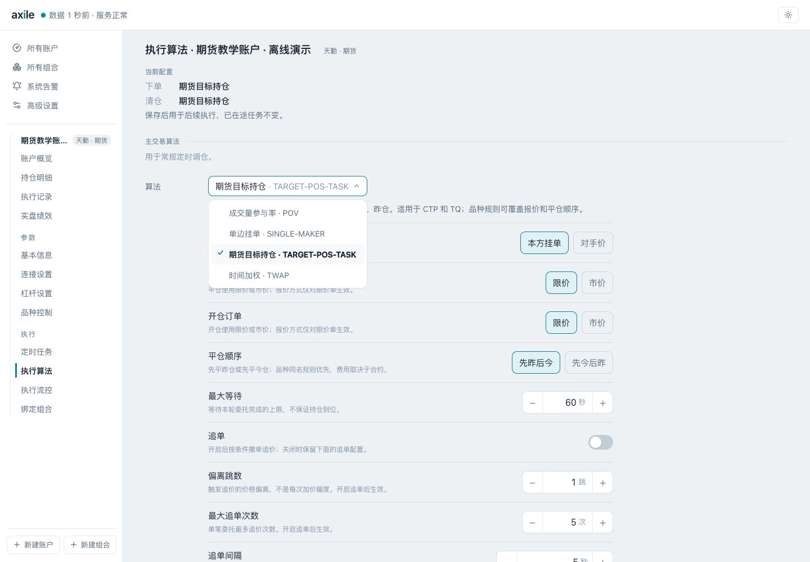

# 执行算法

组合函数给出原始目标权重；执行层规划出可执行数量后，由下单算法处理目标与当前持仓的差量。账户的主交易和清仓可以分别配置算法。

## 当前公共算法目录



| 算法 | 用途 | 需要理解的边界 |
| --- | --- | --- |
| TARGET-POS-TASK | 期货目标持仓，适用于 CTP 与天勤 | 开平仓顺序、报价、等待与追单 |
| SINGLE-MAKER | 单边挂单，可按条件撤单追价 | 主动报价仍可能留下剩量 |
| TWAP | 按时间安排拆单 | 前片欠量滚入后片，计划时长不是严格截止时间 |
| POV | 按收到的增量成交量与参与率跟单 | 无量等待；到期补单可能不再受参与率约束 |
| CTP_OPTION_EXERCISE | CTP 期权行权、放弃或自对冲指令 | 独立指令用途，不用于账户主交易或清仓槽位 |

界面会按当前渠道和主交易 / 清仓槽位过滤可选项。没有出现在当前下拉框中，不等于代码库中没有该算法。

## 参数要结合算法语义看

以 TWAP 为例：

```python
algorithm = {
    "method": "TWAP",
    "params": {
        "total_duration": 300,
        "slices": 10,
        "price_strategy": "ACTIVE",
        "max_wait_seconds": 60,
    },
}
```

计划每 30 秒推进一片，单片最多等待 `min(60, 30)` 秒。前片没有完成的数量会进入后续片，尾片可能集中处理欠量；是否最终到位仍看实际持仓与订单状态。

这段配置用于解释参数，不是对实际账户的执行建议。

## 继续阅读现有实现

- [期货目标持仓](https://github.com/zengbin93/axile/blob/main/axile/executor/algorithms/defaults/ctp_target_pos_task/README.md)
- [单边挂单](https://github.com/zengbin93/axile/blob/main/axile/executor/algorithms/defaults/single_maker/README.md)
- [TWAP](https://github.com/zengbin93/axile/blob/main/axile/executor/algorithms/defaults/twap/README.md)
- [POV](https://github.com/zengbin93/axile/blob/main/axile/executor/algorithms/defaults/pov/README.md)

## 开发自定义下单算法

自定义算法需要通过 `register_algorithm` 注册。算法消费 `AlgorithmInput`，其中包含单品种 `symbol`、已规划的 `target_volume`、品种交易规则和参数，通过 `ExecutorProtocol` 与执行上下文交互，返回 `AlgorithmResult`。

配置“用户算法目录”并重启后，系统扫描目录中的 Python 模块，加载已注册算法。元数据中的参数模型、渠道和槽位影响界面展示与可选范围。

开发前至少理解：

1. 当前渠道的订单参数、开平仓和数量规则。
2. 未知持仓、缺少行情、未完成订单和终态处理。
3. 协作式终止、超时、撤单与剩余缺口。
4. 明确的 `AlgorithmResult`、订单与成交证据、审计事件。
5. 使用 Clock 与执行会话的等待方法，保持可测试性。

接口真源是[算法注册与协议](https://github.com/zengbin93/axile/blob/main/axile/executor/algorithms/core/base.py) 和[加载器](https://github.com/zengbin93/axile/blob/main/axile/executor/algorithms/core/loader.py)。本版文档提供入口和现有实现参考，未提供新的下单算法实战案例。
