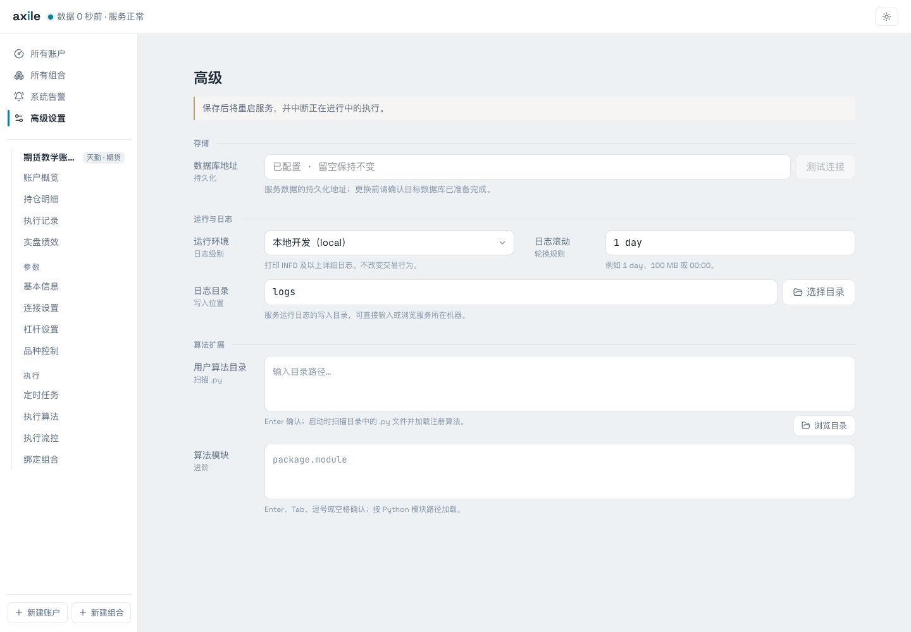

# 渠道与配置

Axile 公共核心内置 CTP、掘金和天勤。选择渠道前，先安装对应依赖，并确认运行平台与账户模式。

## 安装渠道依赖

以下命令在独立 Axile 仓库根目录执行：

| 渠道 | 命令 | 说明 |
| --- | --- | --- |
| 天勤 | `uv sync --extra tqsdk` | 本指南使用的连接表单；支持实盘、快期模拟、本地模拟 |
| CTP | `uv sync --extra ctp` | 依赖 OpenCTP 原生模块，需检查平台和连接环境 |
| 掘金 | `uv sync --extra gm` | SDK 支持的平台运行；macOS 不安装 GM SDK |
| 全部 extras | `uv sync --extra all` | 仍受平台与第三方 SDK 限制 |

源码约束以 [pyproject.toml](https://github.com/zengbin93/axile/blob/main/pyproject.toml) 为准。渠道显示“暂不可用”时，先核对可选依赖，而不是反复提交账户连接表单。

## 账户连接模式

天勤三种模式共用天勤账号与密码。实盘模式另外填写期货公司和交易账户凭据；本地模拟另外填写初始资金。

本地模拟状态保存在当前 Worker 中，日盘或夜盘 Worker 重建后会重置。连接账户和选择运行环境是不同配置；`environment=local` 本身不会把账户变成模拟账户。

## 高级设置

| 设置 | 含义 |
| --- | --- |
| 数据库 | 主服务使用 SQLite；默认位于运行目录 |
| 运行环境 | 控制日志详细程度 |
| 日志目录与滚动 | 日志写入位置及切分周期 |
| 用户算法目录 | 启动时扫描并注册自定义算法的目录 |

主服务从配置文件与代码默认值读取设置，不从 `.env` 读取业务配置。`AXILE_CONFIG_TOML` 可以指定另一份配置文件的位置，它是路径指针，不用于逐项覆盖配置。

需要重新读取的配置在保存后重启生效。裸 CLI 运行时，应再次执行启动命令；托管运行时由外部 supervisor 拉起。
