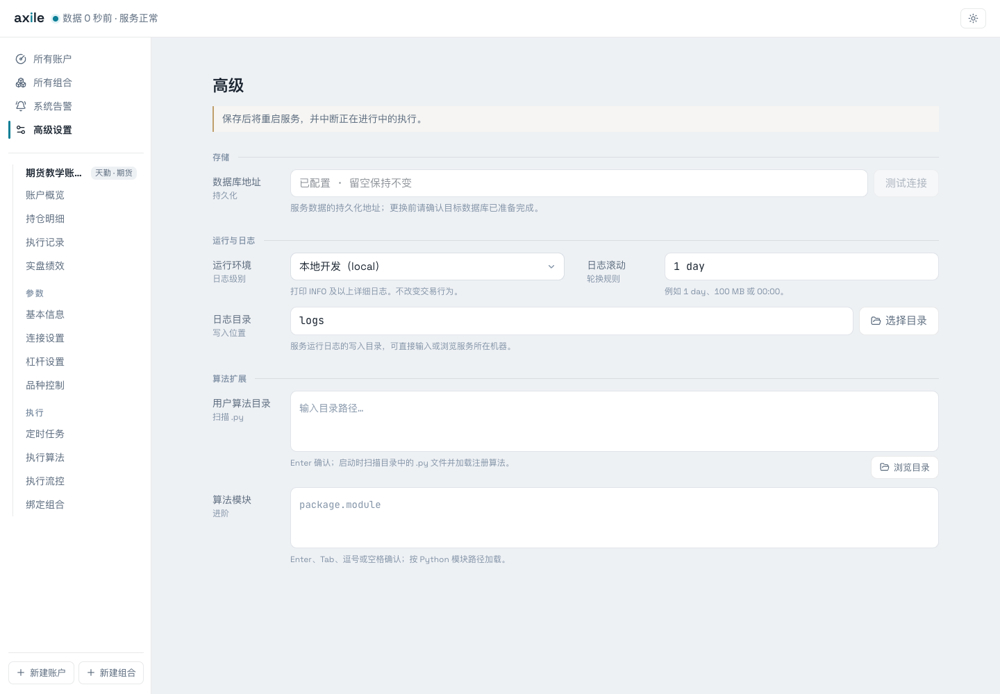

# 渠道与配置

Axile 公共核心内置 CTP、掘金和天勤。使用前需要安装对应依赖，确认 SDK 支持的运行平台，并选择账户模式。

## 安装渠道依赖

以下命令在独立 Axile 仓库根目录执行：

| 渠道 | 命令 | 说明 |
| --- | --- | --- |
| 天勤 | `uv sync --extra tqsdk` | 本指南使用的连接表单；支持实盘、快期模拟、本地模拟 |
| CTP | `uv sync --extra ctp` | 依赖 OpenCTP 原生模块，需检查平台和连接环境 |
| 掘金 | `uv sync --extra gm` | SDK 支持的平台运行；macOS 不安装 GM SDK |
| 全部 extras | `uv sync --extra all` | 仍受平台与第三方 SDK 限制 |

依赖要求见 [pyproject.toml](https://github.com/zengbin93/axile/blob/main/pyproject.toml)。渠道显示“暂不可用”时，先检查对应依赖是否已安装；反复提交连接表单无法解决依赖缺失。

## 账户连接模式

天勤三种模式共用天勤账号与密码。实盘模式另外填写期货公司和交易账户凭据；本地模拟另外填写初始资金。

本地模拟状态保存在当前 Worker 中，日盘或夜盘 Worker 重建后会重置。实盘或模拟由账户连接模式决定，运行环境 `environment=local` 只影响日志，不会把账户改成模拟账户。

## 连接与记录核对

账户概览的连接开关用于连接或断开账户，旁边的详情入口显示进度、核对结果和失败原因。修改连接设置后，重新确认账户状态。连接就绪后再查询资产、计算目标或执行交易。

打开页面不会登录账户。执行结束或暂停自动执行后，已有连接仍保留；主动断开后需要显式重新连接，重连不会解除暂停或触发调仓。断线期间的历史成功状态不能证明当前在线，先核对连接详情和最新观测时间。

CTP 和天勤的近期委托、成交查询覆盖柜台当前交易日，并合并本次连接的观测记录；掘金使用当前可查询记录。具体范围以弹窗中的“记录范围说明”为准。各渠道提供的开平仓、交易日、费用等字段不同，缺少字段时不补算。

主动核对最近委托、成交或在途委托后，服务端会联动查询并保存资产持仓，账户概览及持仓目标对照随之刷新；重新打开页面也使用已保存的新快照。普通轮询、分页不额外查询渠道持仓。执行中无法补查、查询失败或仍在等待时，记录和持仓结果分别报告，旧持仓保留并提示待核对。

关闭弹窗后，已开始的核对仍在后台继续；执行中的账户会等执行结束后补查。页面按本次任务的最终结果确认成功，并等待概览读到对应资产快照后清除提示，其他查询写入的新快照不会代替本次核对结果。服务重启或任务结果已失效时，需要重新核对。

操作步骤见[第一个组合](/guide/first-portfolio)和[委托与成交](/guide/activity)。

CTP 与天勤共用内存合约目录，服务重启后按执行所需补齐，不要求先加载全市场。下单所需资料未齐全时不会发送订单。目录只提供静态合约资料，行情、手续费和账户权限仍由对应渠道提供。

## 调仓收尾规则

各渠道继续按先减后增执行，品种并发方式不变。减仓结束后的账户查询同时用于阶段到位判断和下一阶段目标重算；新一阶段执行后再查询账户，统一生成最终持仓与到位结论。

仅由旧持仓观测产生的“目标未完成”可以根据收尾快照纠正；实际报单、撤单和账户控制错误继续保留。账户查询失败时保留已有执行证据，继续阻断后续开仓。休市跳过规则不变，历史记录不自动改写。

掘金的撤单拒绝等非成交回报不会记为成交；实时回调和历史查询使用相同的成交转换规则。

## 高级设置

| 设置 | 含义 |
| --- | --- |
| 数据库 | 主服务使用 SQLite；默认位于运行目录 |
| 运行环境 | 控制日志详细程度 |
| 日志目录与滚动 | 日志写入位置及切分周期 |
| 用户算法目录 | 启动时扫描并注册自定义算法的目录 |

主服务读取配置文件和代码默认值，不从 `.env` 读取业务配置。`AXILE_CONFIG_TOML` 用来指定配置文件路径，不能逐项覆盖配置。

保存需要重新读取的配置后，要重启服务。直接用 CLI 启动的，再执行一次启动命令；托管运行的，由外部 supervisor 重启。

## 调仓信号

从「新建账户」选择「调仓信号」，绑定已有组合。账户继承组合的市场。可以填写权益、可用资金、币种及实际持仓，也可以配置账户函数。首次入金单独记入资金流水。

- `fetch_account(context)` 返回包含 `total_asset`、`available_cash`、`currency` 和可选 `positions` 的字典。定时计算前和手动刷新权益时调用。省略 `positions` 表示未知持仓，返回空列表表示确认空仓。上下文提供市场、账户名称及账户 ID，开户试算时还没有账户 ID。
- `fetch_quotes(symbols)` 按请求标的返回字典。每个值包含 `last_price` 和带时区的 ISO 格式 `update_time`。在组合函数调用 `context.get_price()` 或 `context.get_quote()` 时按需取数，数据源由用户提供。
- 组合函数返回 `{"mode": "quantity", "targets": {...}}`。编辑页试算和手动重算可预览目标。定时任务保存目标并按账户通知配置推送。默认卡片按完整目标列出数量，账户由用户自行在券商端交易。
- 自定义通知可判断 `event_type == "signal.calculated"`，并从 `targets.current` 读取完整目标数量。有实际持仓时，`positions` 提供当前持仓供自定义通知计算差额。
