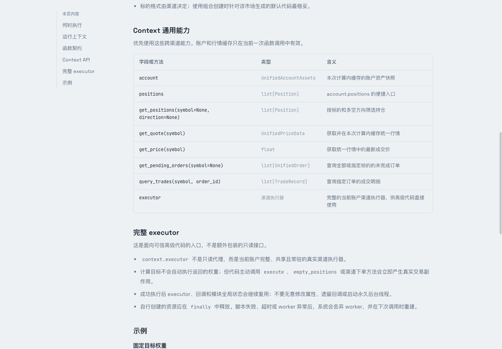

# Context 查询接口

在 `calculate_portfolio(context)` 中，可以通过 Context 读取账户和行情的统一模型。常用查询可直接用下表中的跨渠道方法，需要渠道专有功能时再使用完整 executor。

## 函数契约

```python
def calculate_portfolio(context):
    return {"rb2701": 0.4, "ag2612": -0.25}
```

函数只能接收一个参数 `context`，返回权重字典，或显式的 `{"mode": "quantity", "targets": {...}}`。标的映射的键是字符串品种代码，值是有限数字，不能用布尔值。正数表示目标多头，负数表示目标空头，空字典表示目标空仓。

旧字典返回原始目标权重，之后应用账户杠杆和权重精度；显式数量模式直接给出目标数量，两种模式均保留执行控制。调用时机见[组合函数指南](/guide/functions#什么时候会调用函数)。

## 查询方法

| 字段或方法 | 返回类型 | 含义 |
| --- | --- | --- |
| `settings` | `ContextSettings` | 只读执行配置：`long_leverage`、`short_leverage`、`weight_precision`；杠杆与执行层一致，已解析渠道默认值 |
| `account` | `UnifiedAccountAssets` | 本次调用内缓存的账户资产快照 |
| `positions` | `list[Position]` | `account.positions` 的便捷入口 |
| `get_positions(symbol=None, direction=None)` | `list[Position]` | 按标的和方向筛选持仓 |
| `get_quote(symbol)` | `UnifiedPriceData` | 获取并缓存统一行情 |
| `get_price(symbol)` | `float` | 统一行情的最新成交价 |
| `get_pending_orders(symbol=None)` | `list[UnifiedOrder]` | 查询未完成订单 |
| `query_trades(symbol, order_id)` | `list[TradeRecord]` | 查询指定订单的成交明细 |
| `executor` | 当前渠道执行器 | 完整、共享且常驻的执行器对象 |



## 常用模型字段

`context.settings` 固定为本次计算的配置快照，不包含渠道凭据。无账户样例使用多空杠杆 `1.0`、权重精度 `0.01`。权重模式仍会在执行层应用对应方向的账户杠杆和权重精度；数量模式直接指定最终目标数量，跳过这两项缩放。

| 模型 | 常用字段 |
| --- | --- |
| 账户资产 | `total_asset`、`available_cash`、`market_value`、`positions`、`currency`、`source` |
| 持仓 | `symbol`、`volume`、`available_volume`、`direction`、`market_value`、`avg_price` |
| 行情 | `symbol`、`last_price`、`bid_price`、`ask_price`、`timestamp`、`extra` |
| 订单 | `order_id`、`symbol`、`direction`、`volume`、`filled_volume`、`status` |
| 成交 | `trade_id`、`order_id`、`symbol`、`trade_volume`、`trade_price`、`trade_value` |

持仓方向使用 `PositionDirection`，其值包括 `多头`、`空头`、`净`。查询示例：

```python
from axile.executor.models.unified_account_assets import PositionDirection

long_positions = context.get_positions("rb2701", PositionDirection.LONG)
quote = context.get_quote("rb2701")
```

## 缓存范围

账户资产和已查询的行情只在本次函数调用内缓存，同一品种的行情会复用。下一次计算会创建新的 Context。样例上下文中可能没有行情 `extra` 里的渠道字段。

## 完整 executor

::: warning executor 可以下单
`context.executor` 是实际的渠道执行器，调用 `execute`、`empty_positions` 或渠道下单方法会产生真实交易。在真实账户中试跑函数时，也一样可以下单。
:::

一次请求成功后，executor、回调和模块全局状态可能继续复用。修改属性、注册回调或启动永久线程时，要考虑对后续调用的影响。自行创建的资源应在 `finally` 中释放。脚本失败、超时或 Worker 异常后，系统会丢弃该 Worker，在下次调用时重建。

完整定义见 [Context 源码](https://github.com/zengbin93/axile/blob/main/axile/server/context.py) 和[统一模型目录](https://github.com/zengbin93/axile/tree/main/axile/executor/models)。
